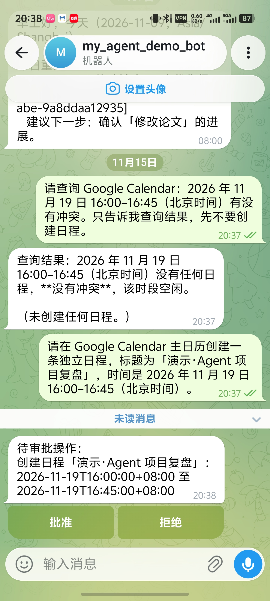
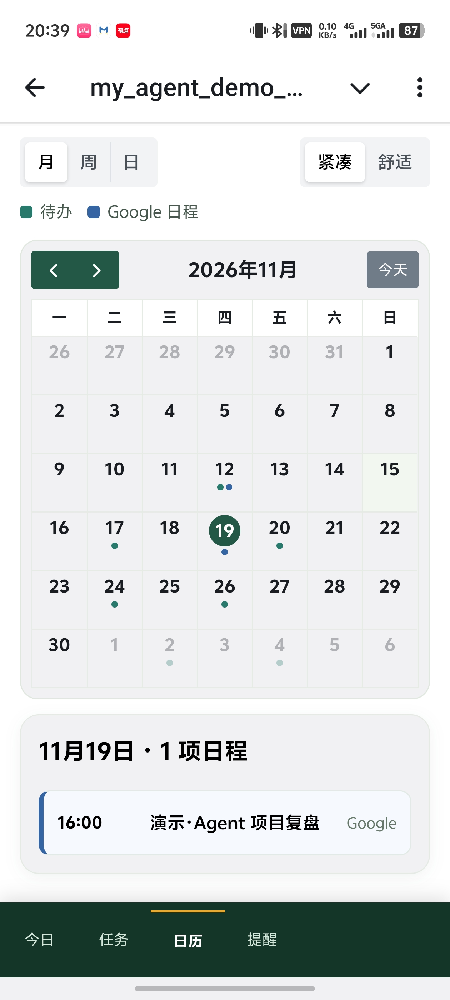
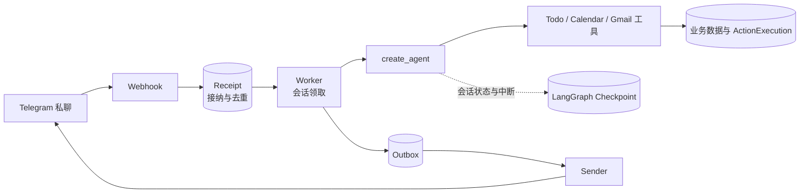

# Telegram Personal Assistant

一个以 Telegram 对话为入口的 AI 个人助理：用自然语言管理待办、查询日历与邮件，在敏感操作前请求批准，并在提醒到期时主动通知。手机端 Web 工作台用于查看日程和直接管理结构化数据。

**技术标签：** `Python 3.12` · `FastAPI` · `LangChain create_agent` · `LangGraph` · `PostgreSQL 18` · `MCP` · `React` · `TypeScript`

## 产品预览

| Telegram：查询日历与审批 | Mini App：日历 |
| --- | --- |
|  |  |

## 核心功能

| 场景 | 使用方式 |
| --- | --- |
| 自然语言待办 | 在 Telegram 里创建、查询、修改 Todo，设置提醒；删除等敏感操作先由用户通过 Telegram 按钮批准。 |
| 日历与邮件 | 查询 Google Calendar 事件与空档，按可信候选安排 Todo；读取已授权 Gmail 邮件辅助整理任务。Google Calendar 通过本地 MCP Server 接入，Gmail 只读，不发送邮件。 |
| 主动通知 | 后台发现到期提醒并生成每日简报，持久化后由出站程序投递；Agent 不必一直运行到提醒时间。 |
| 手机工作台 | 在 Mini App 的今日、任务、日历和提醒页面查看及管理数据。普通表单操作直接调用后端 API，当前没有通用 Web 聊天界面。 |

Google 账号授权范围与单账号限制见[集成说明](docs/google-integration.md)。

## 一个使用示例

用户可以说：“帮我创建一个待办，复习 FastAPI 路由，不设置提醒。”Agent 根据请求选择 Todo 工具；服务端核对用户身份与参数，将待办和执行记录写入 PostgreSQL；工具结果再交给 Agent，最终答复经 Outbox 发送到 Telegram。

这是**交互方式示例，不是公开的真实模型对话截图**。仓库的[隔离 Agent 演示](ops/smoke_official_agent.py)已用固定响应的 Fake Chat Model 验证 `create_agent → 工具调用 → Todo 入库 → 最终回复`，没有调用真实模型或 Telegram。真实模型的工具选择与措辞需在独立测试环境另行验收。

敏感操作的路径不同：Agent 先保存待审提案并暂停；Telegram 按钮针对这项提案作出决定，恢复时重新核对用户、目标和版本，再继续执行。批准按钮本身不等于业务已经成功。

## 主要技术亮点

- **统一 Agent：** LangChain `create_agent` 负责模型与工具的循环，LangGraph 保存会话状态；项目在工具执行端落实身份、权限、参数和业务约束。
- **审批与恢复：** HITL 在写入前暂停；Checkpoint 保存可恢复的 Agent 状态，审批决定绑定原操作。业务目标变化时不能套用旧批准。
- **可靠执行：** Receipt 先持久化 Telegram 入站更新，Worker 按会话领取；本地 Todo 与 ActionExecution 在同一事务提交。最终答复进入 Outbox，由独立 Sender 投递。Google 远端写入另需核对执行证据，超时不能直接当作失败。
- **主动任务：** Scheduler 扫描到期提醒和每日简报需求，形成持久任务后复用 Outbox 发送。
- **Agent Evaluation：** 现有 40 条合成任务覆盖工具选择、跨工具依赖、业务状态与异常场景；结合确定性 Oracle、轨迹和可选统一 LLM Judge 分析结果，不把历史实验分数当作当前线上成功率。

## 系统架构

Telegram 的消息处理分为**接纳、执行、投递**三个阶段：



Webhook 保存 Receipt 后即可响应 Telegram；Worker 随后运行 Agent，工具结果回到 Agent。Agent 结束或等待审批后，Worker 才将最终答复或审批卡片写入 Outbox；Sender 独立发送，Telegram 投递不是数据库事务的一部分。

- **审批恢复：** Telegram 按钮作为新的入站更新进入 Receipt/Worker，按原提案恢复 Checkpoint 并核对执行结果。
- **主动通知：** Scheduler 独立查找到期任务，生成通知和 Outbox 记录；不靠模型在指定时间“醒来”。
- **Web 工作台：** React 页面通过结构化 API 读写同一用户的业务数据，不经过 Telegram 消息 Worker，也不运行另一个 Web Agent。

详见[系统架构](docs/architecture.md)和[Agent 设计](docs/agent-design.md)。

## 快速开始

**基础环境：** Windows、Python 3.12、PostgreSQL 18、Node.js/npm。下面是已验证的**隔离本地 Web 工作台**路径；基础 Todo 页面不需要 Google OAuth、真实 Bot 或模型调用。准备自己的空闲高位数据库端口，不要连接现有生产库。

```powershell
py -3.12 -m venv .venv
& .\.venv\Scripts\python.exe -m pip install -r requirements-dev.txt
Copy-Item .env.example .env
Push-Location web
npm ci
npm run build
Pop-Location
```

```powershell
& .\.venv\Scripts\python.exe ops/local_staging.py init --port 56520 --pg-bin 'C:\Program Files\PostgreSQL\18\bin'
& .\.venv\Scripts\python.exe ops/local_staging.py web-user --port 56520
& .\.venv\Scripts\python.exe ops/local_staging.py serve --port 56520 --web
```

打开 `https://127.0.0.1:18443/workbench/`。本地自签名证书可能触发浏览器提示；结束后停止服务，并用 `& .\.venv\Scripts\python.exe ops/local_staging.py stop --port 56520` 停止隔离数据库。数据库目录必须是新建的，`init` 不会覆盖已有目录；PostgreSQL 安装位置不同则调整 `--pg-bin`。

**完整 Telegram Agent** 还需要你自己的模型 API、Bot、HTTPS Webhook 及相应启动预检；Google 功能另需授权。配置和启动边界见[部署说明](docs/deployment.md)，离线验证方式见[测试说明](docs/testing.md)。

## 技术栈

| 层次 | 技术 |
| --- | --- |
| 后端与持久化 | FastAPI、SQLAlchemy、PostgreSQL 18 |
| Agent 与状态 | LangChain `create_agent`、LangGraph、PostgreSQL Checkpointer / Store |
| 外部集成 | Telegram Bot API、Google Calendar MCP、Gmail OAuth |
| 手机工作台 | React、TypeScript、Vite、FullCalendar |
| 评测 | pytest、隔离 PostgreSQL、Fake Calendar/Gmail、确定性 Oracle、可选统一 LLM Judge |

## 项目结构

以下仅列当前主链的入口与关键文件，可据此继续阅读源码：

```text
app/
  main.py                         FastAPI 装配
  agent/
    official_graph.py             create_agent 图与工具装配
    official_runtime.py           Agent 执行入口
    official_context.py           模型调用上下文
    official_permissions.py       工具可见性和授权
    official_todo_tools.py        Todo 工具
    official_todo_approval.py     Todo 审批
    unified_tools.py              日历等业务工具
    agent_approval.py             审批状态与恢复
    calendar.py                   Calendar 集成
  telegram/
    webhook.py                    Telegram 入站入口
    durable.py                    Receipt 与领取机制
    durable_runtime.py            入站任务执行
    sender.py                     Outbox 投递
  db/
    models.py                     业务与可靠性数据模型
    session.py                    数据库会话
    offline_initialize.py         新库初始化
    migrations/                   兼容迁移
  scheduler/
    reminders.py                  到期提醒
    daily_brief.py                每日简报
  web/
    api.py                        Web API 装配
    auth.py                       Web 会话
    today.py                      今日 API
    todos.py                      任务 API
    calendar.py                   日历 API
    reminders.py                  提醒 API
web/src/
  workbench.tsx                   React 工作台入口
  calendar_page.tsx               手机日历
  api.ts                          前端 API 调用
agent_benchmark/
  dataset.py                     任务数据适配
  ground_truth.py                Ground Truth 视图
  oracle_v2a.py                   确定性判分
  unified_judge.py                统一 Judge
  unified_report.py               精简指标报告
ops/                               隔离开发与冒烟脚本
tests/                             单元、Mock 与集成测试
docs/                              架构、部署、集成、评测与截图
```

## 进一步阅读

[系统架构](docs/architecture.md) · [Agent 设计](docs/agent-design.md) · [Google 集成](docs/google-integration.md) · [Evaluation](docs/evaluation.md) · [部署](docs/deployment.md) · [测试](docs/testing.md) · [文档导航](docs/README.md)
