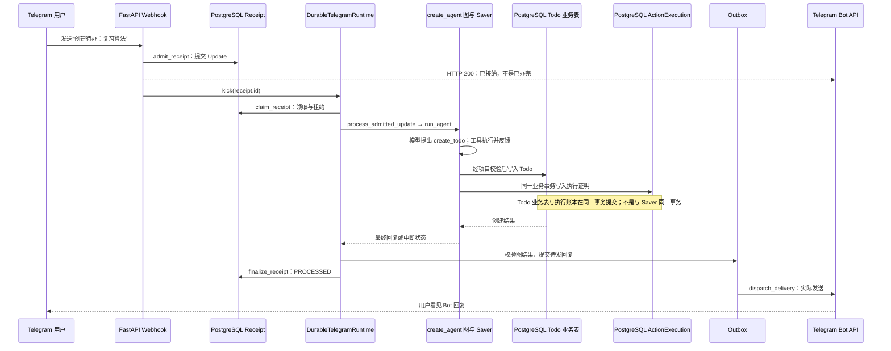

# 第 00 章｜一条消息怎样变成真实的 Todo

本章只追踪当前生产路径中的一种普通请求：用户在 Telegram 私聊发送“创建一个待办：复习算法，不设置时间”，直到 Bot 回复。它不是审批按钮、`/workbench` 命令或 Web/Mini App 请求的通用模板。我们先把整条路走通；工具协议、事务和故障恢复的细节留给后续章节，但本章遇到的每一个关键函数，都要知道是谁调用它、拿到什么、判断什么、做了什么、结果交给谁。

读完后，你应能区分四件经常被混称为“成功”的事：**Telegram Update 已被接纳、Todo 已写入业务表、Agent 的工具结果已保存、Bot 回复已被 Telegram 接受**。它们发生在不同的代码和持久记录里，不能用其中一件推断另外三件。

## 0.1 先认识参与者，而不是先记框架名

Telegram 发给后端的不是直接的 Python 函数调用，而是一条 HTTP 请求，正文是包含 `update_id`、发送者和消息文本的 JSON。`app/telegram/webhook.py` 把 `/webhook` 注册成接收地址。HTTP 是客户端向服务端发送请求、服务端返回状态码的通信方式；这里 Telegram 是请求方，我们的 FastAPI 应用是接收方。Webhook 的意思是 Telegram 有新事件时主动 POST 给这个地址，不是后端不断向 Telegram 轮询。

后端没有在这次 HTTP 请求里等待模型把事情办完。它先把消息记在 PostgreSQL 的 `telegram_inbound_receipts` 表中。**Receipt** 在这里是项目命名的一条“入站消息接纳记录”，不是 Telegram 官方替我们完成业务的收据。随后后台 Worker 领取这条记录，找到项目里的业务用户，运行 Agent。Agent 是“模型可以选择工具、读取工具结果后再决定下一步”的程序；它不是一个能直接写数据库的模型。模型可以提出 `create_todo`，真正写入的是项目的 Python/SQLAlchemy 代码。

这条普通路径可以先画成一张总图：



图中的两次“提交”不是一个大事务：Todo 业务事务、LangGraph Saver、Receipt/Outbox 各有自己的提交边界。因此中途出错时，可能出现“Todo 已存在，但 Agent 尚无完整结果”这样的中间状态。图示的是正常路径；分支和故障点在下面逐步展开。

## 0.2 应用启动时，谁把 Agent 和 Worker 接起来？

`app/main.py` 的应用生命周期代码在启动阶段调用 `official_runtime.build_graph(db_session_factory=AsyncSessionLocal, store=store, ...)`，并检查返回的图确实有 checkpointer；缺少 Saver 时不会悄悄降级成无持久化 Agent（`app/main.py:250-278`）。这里的 `AsyncSessionLocal` 是业务数据库会话工厂：需要访问 Todo、User 等表时，用它创建一段数据库会话。`store` 是供跨线程 Profile 等资料使用的 LangGraph Store，**不是**本次 Todo 的业务表，也**不是**保存会话图状态的 Saver。

`build_graph`（`app/agent/official_runtime.py`）在生产 `durable=True` 路径建立 PostgreSQL 连接，构造 `AsyncPostgresSaver` 并执行 `setup()`；然后把模型、业务数据库会话工厂、Saver 和 Store 交给 `build_official_agent`。后者在 `app/agent/official_graph.py::build_official_agent` 创建**当前模型可见的一组项目工具**，再调用 LangChain `create_agent(...)` 得到可运行图。普通 Todo 只注册一层模型可见的 `@tool`，内部调用普通 Python 业务函数；日历工具另有服务边界适配器，第 01 章会分清两者。图里的模型—工具循环由框架运行；项目提供身份与权限、上下文、审批和定向错误处理规则。复用旧模块中的某些业务函数或 Prompt 片段，不意味着旧手写工具游标是当前执行器。

同一启动流程还要让 Telegram 入站组件可用。`app/main.py:416-435` 在数据库、消息表与 Bot 身份等依赖满足后调用 `telegram_durable.start()`。`DurableTelegramRuntime.start()`（`app/telegram/durable_runtime.py:42-64`）先通过 Bot API `get_me()` 验证 Bot 身份，检查 Receipt、Outbox 和线程租约表能访问，再启动恢复扫描循环。若这部分没准备好，Webhook 不应把新 Update 当成可接纳的正常请求。启动时失败不等于 Todo 代码有错；它可能是数据库、Bot 凭据、Saver 或持久消息组件不可用。

## 0.3 第一站：Webhook 只承诺“接纳”

`telegram_webhook(request)` 是 FastAPI 在收到 `POST /webhook` 时调用的异步函数（`app/telegram/webhook.py:632-702`）。`async def` 表示函数能在等待数据库或网络结果时让出执行权；它不表示这个函数自动在另一个进程执行，也不表示业务已经并行完成。

它首先比较请求头 `X-Telegram-Bot-Api-Secret-Token` 与项目配置的 Webhook 秘密：不一致返回 HTTP 403。随后检查应用运行时和持久接纳组件是否 ready；未准备好返回 503，提示 Telegram 稍后再投递。JSON 无效则返回 400。在接纳锁内它再次检查是否正在关闭，避免刚通过第一次检查就与停机交错。接着 `normalize_update(data)`（`app/telegram/durable.py:113-172`）验证 `update_id`、发送者和聊天 ID，提取足够重放的文本/按钮内容，生成规范化内容摘要。不是支持的消息形态会走终止性接纳或被拒绝；本章的普通文本会继续。

正常文本进入 `admit_receipt(...)`（`app/telegram/durable.py:175-208`）。它使用已验证 Bot 的 `bot_identity`、Telegram 的 `update_id`、规范化内容及项目线程键，在 PostgreSQL 里插入 `RECEIVED` Receipt。数据库对 `(bot_identity, update_id)` 有唯一约束；同一 Update 重投时读回既有记录，未被脱敏的同一身份若内容摘要冲突则拒绝。`db.commit()` 成功之后，Webhook 才调用 `durable.kick(receipt.id)` 唤醒后台处理并返回 `{"ok": true}`。若提交失败，返回 503；若已经提交但 `kick` 不可用，也返回 503，已提交记录仍可由恢复扫描发现。

所以，**HTTP 200 证明这条正常 Update 的接纳记录已提交，不证明 Agent 已运行**。此时 `todos` 表完全可能还没有新行。Telegram 重投 Webhook 和项目 Worker 重试已有 Receipt 是两件不同的事；重复 Update 不应因此变成两条新的业务请求。

## 0.4 第二站：Worker 领取 Receipt，才开始执行用户请求

`kick` 创建一个处理任务，真正的处理函数是 `DurableTelegramRuntime._process(receipt_id)`（`app/telegram/durable_runtime.py:81-86,114-175`）。如果进程重启、没有即时唤醒，`_recover_loop` 也会扫描 `RECEIVED`、达到再试时间的 `FAILED` 和租约过期的 `PROCESSING` Receipt（同文件 `187-237`）。这个扫描器不是模型，也不把失败直接翻译成“用户任务失败”。

`_process` 先调用 `claim_receipt`（`app/telegram/durable.py:243-293`）。它用数据库行锁检查记录未终结、尚未被有效租约持有、失败重试时间已到，并检查同一线程更早的未终结记录。成功时同时取得 Receipt 与线程租约，设为 `PROCESSING`、写入新的 `fence_token`、`lease_until`，把 `attempts` 加一并提交。这里的**租约**是“这段时间由当前 Worker 处理”的期限；**fence token** 是本次领取的唯一令牌，防止过期 Worker 再把旧结果当成新结果提交。它们不等于 Agent 的 `thread_id` 或用户身份。

Worker 随后取出已保存的规范化内容，在同线程调用保护下执行 `process_admitted_update(envelope)`；调用期间 `receipt_scope(receipt_id, token)` 让后面的 Todo 提交和回复排队知道自己属于哪条持久入站记录（`app/telegram/durable_runtime.py:122-148`，`app/telegram/processing_context.py:12-65`）。如果已有完整业务结果证明和全部回复意图，Worker 可以不重跑 Agent，而直接收尾。普通异常由 `_process` 记录类别并交给 `fail_receipt`，它按当前尝试次数转成 `FAILED` 或 `DEAD`；被取消或进程直接崩溃则留待租约/恢复处理。这些规则是入口处理规则，不能拿来推断 Todo 是否已提交。

`process_admitted_update`（`app/telegram/webhook.py:705-939`）把保存的字典重新解析成 Telegram Update，读取发送者的回复偏好。**这里才开始分流：**审批按钮走 callback handler；`/start`、`/help`、`/workbench` 走命令分支；语音先转写；本章的普通文本继续。代码从 `message.from_user` 取得 Telegram 用户 ID，用 `get_or_create_user` 查找或创建 `users` 表记录，并 `db.commit()`；得到的内部 `user.id` 才是 Todo 表的 `user_id`（`webhook.py:843-855`，`app/db/crud.py:13-21`）。因此 Telegram ID、聊天 ID 和业务用户 ID 不应混成一个字段。

普通文本到达 `run_agent` 之前，还会检查现有待审批状态；若当前图已暂停等待决定，新消息不能悄悄绕过原审批（`webhook.py:900-928`）。源码中仍有针对既存特殊线程的条件分支，本章只以“通过这项检查后的普通新请求”为主线；不能说所有 Telegram Update 都必经 Agent。

## 0.5 第三站：`run_agent` 怎样找到会话，却不把会话键当权限？

Webhook 调用 `official_runtime.run_agent(graph, user_id, telegram_id, chat_id, user_message, ...)`（`webhook.py:923-928`）。这些参数并不是模型自己填写的：`user_id` 来自刚提交的 `users` 行，`telegram_id` 和 `chat_id` 来自已解析的 Telegram Update，`user_message` 是本次文本。

`run_agent`（`app/agent/official_runtime.py:150-259`）先决定两个不同的标识：

| 标识 | 本例中的形状 | 解决的问题 |
| --- | --- | --- |
| Receipt ID | 项目生成的 UUID | 哪一条已接纳的 Telegram Update 正在被处理 |
| `HumanMessage.id` | `telegram-receipt:` + Receipt ID | 重试时识别“这仍是同一轮用户输入” |
| Saver `thread_id` | `official-v1:user_` + Telegram ID | 到 PostgreSQL Saver 找到同一对话的图状态 |
| 内部 `user_id` | `users.id` | Todo、Profile 等业务数据归谁所有 |
| Tool Call ID | 模型为一次工具调用给出的 ID | 哪个 ToolMessage 对应哪个操作，也参与本入口的重放证明 |

`thread_id` 是**查找键，不是授权证明**。这里说的“Checkpoint 归属用户”不是名为 `owner` 的字段，而是 Saver 快照的 State 中保存的内部 `user_id`。函数用 `thread_id` 调用 `graph.aget_state(config)` 读取快照；若快照已有 `user_id` 且不等于本次服务端确认的 `user_id`，立即抛 `CheckpointOwnerMismatch`。它还比较 Saver 里是否已有相同 `HumanMessage.id`：同一 Receipt 重来，不能再把用户原话追加为新轮；若图停在未完成节点，只有原持久入口可用 `graph.ainvoke(None, ...)` 续跑。新的 Receipt 即使来自同一个 Telegram ID，也不能接管上一轮未完成节点。等待审批的图同样不接受新的普通请求直接越过中断（`official_runtime.py:167-200`）。

若是新请求，函数**从本次入站文本创建** `HumanMessage(id=incoming_id, content=user_message)`，再构造一份 State 更新，包含当前消息、`active_request`、本轮 ID 与来源；仅在该线程尚无快照时，还写入 `user_id`、`telegram_id`、`chat_id` 这些实际身份字段。之后调用 `graph.ainvoke(update, config=config, context=context)`（`official_runtime.py:201-237`）。Saver 中的旧消息不是被拼成一条新的 HumanMessage；它们是图 State 的历史消息，由 `thread_id` 取回并与本轮消息合并。当前版本可能在首次进入新命名空间时执行核对原有 `user_id` 的最近历史迁移，但这是有条件的迁移分支，不是每轮请求都会发生。

`context` 里也有 `user_id`、Telegram ID、聊天 ID 和入口来源。它由本次可信入口传给 LangGraph 的 `Runtime.context`，而不是作为模型可编辑的 Tool 参数。State 保存的 `user_id`、`telegram_id`、`chat_id` 等身份字段，可在恢复 Checkpoint 时与本次入口传来的身份核对；这里没有单独的 `owner` 字段。`require_agent_runtime_identity` 会逐项比较两边，不一致就拒绝（`app/agent/state.py:5-23`）。**Saver 能按线程找状态，服务端身份检查负责判断本次请求能不能使用它。**

## 0.6 第四站：模型只能提出操作，Python 工具才可能写入 Todo

在 `create_agent` 图中，项目提供工具列表和 Middleware（`app/agent/official_graph.py::build_official_agent`）。官方框架负责模型节点、工具节点、工具结果再回模型的循环。项目的 `OfficialToolAuthorization` 在每次模型调用前，根据服务端身份与配置过滤可见工具；真正执行某个工具前再检查一遍（`app/agent/official_permissions.py::OfficialToolAuthorization`）。例如 Calendar/Gmail 需要启用，且本次 Telegram ID 分别等于配置项 `google_calendar_owner_telegram_id` / `gmail_owner_telegram_id`（`app/agent/unified_tools.py::available_tools`）。这里配置名中的 `owner` 指单个 Google 授权账号被允许对应的 Telegram 用户，**不是**上一节 Checkpoint State 的字段。**工具在模型眼前不可见**与**执行边界仍拒绝越权调用**是两层不同保护。

最小消息过程如下。右侧是教学示意，不是某次真实 Trace 的逐字内容：

```text
HumanMessage: “创建一个待办：复习算法，不设置时间”
AIMessage.tool_calls: [{name: "create_todo", args: {title: "复习算法"}, id: "call-示意"}]
ToolMessage: {tool_call_id: "call-示意", status: "success", content: "已创建…"}
AIMessage: “已创建待办‘复习算法’，没有设置时间。”
```

`AIMessage` 是模型返回的消息；其中的 Tool Call 是**调用提案**，还不是数据库事实。框架工具节点把它交给项目注册的 `create_todo`。`ToolMessage.tool_call_id` 对应原提案的 ID，模型下一次推理才能知道哪个调用成功、哪个失败；若模型不再提出工具调用，框架才走向该轮结束。框架源码中当前版本把同一 `AIMessage` 的待处理调用分别送往 `tools` 节点（`.local-tools/official-langchain-1.4.6/langchain/agents/factory.py:1997-2032`）；不能把“同时提了两个工具”讲成“必然先完成第一个再执行第二个”。

本例的模型可见 `create_todo` 定义在 `app/agent/official_todo_tools.py::make_official_todo_tools`。框架的 `ToolRuntime` 给它注入当前 State、可信 `Runtime.context` 和原 Tool Call ID；模型可填的参数没有 `user_id` 或 Call ID。**在进入工具函数之前**，`OfficialToolAuthorization.awrap_tool_call` 从 `active_request` 检查用户是否授权创建这个标题；若填了时间，还用模型提供的 `time_source_quote` 核对时间确实来自当前 Todo 的用户原话。确定的授权拒绝由 Middleware 返回带原 Call ID、`status="error"` 的 ToolMessage，工具不会运行。本例没有时间字段，所以不进入时间来源校验。工具函数自身再用 `trusted_request(runtime)` 核对本次可信身份与 State 的身份相同、当前原话存在，然后将 `user_id` 和原 Call ID 传给**普通 Python 业务函数**，而不是再调用第二个 LangChain `@tool`（`app/agent/official_permissions.py::awrap_tool_call`；`app/agent/official_todo_tools.py:11-45`）。未知的写入异常没有被一概捕获成“确定未执行”。

普通业务函数 `app/agent/tools.py::make_todo_operations` 中的 `create_todo` 解析可能存在的时间，打开业务数据库会话，以 `crud.create_todo` 构造 `Todo(user_id=..., title=..., ...)` 并 `flush`（`app/agent/tools.py:126-199`；`app/db/crud.py:31-69`）。`flush` 是把 SQL 送到数据库、取得行的字段，**还不是最终提交**。这里的“合为一层”只指**一层模型可见的 LangChain 工具**；业务函数仍保留，因为它承担数据库语义。

为什么提交 Todo 还要多记一条记录？假如 Todo 已提交，但程序在工具结果写回 Saver 之前崩溃，同一条 Telegram 消息重试时，不能再创建第二条。这里把“这次工具写入是否已提交、原结果是什么”的记录称为**执行证明**；它不是另一次业务操作。当前 Telegram 普通 Todo 把证明存入 `action_executions`：它与审批执行、WebRequest 普通 Todo 共用一张表，**但三种入口并不共用同一个授权或重试规则**。先只看本例：

```text
Receipt ID ＋ 工具名 ＋ 原 Tool Call ID
              │ 稳定计算 action_id（本入口以 tgtodo: 开头）
              ▼
commit_todo_tool_operation
  先锁 Receipt 行，核对 PROCESSING、租约和 fence token
  再核对 Call ID、可信 user_id，计算工具参数摘要
              │
              ▼
向 action_executions 插入该 action_id（唯一键）
       ┌──────┴──────┐
     插入成功       唯一键已存在
     首次执行       同一身份重入
       │                 │
  perform() 写 Todo    核对 owner、操作、Receipt ID、
  证明标为 executed   参数摘要、状态和原结果
  两者一起 commit      │
       │           全相符 → 返回原结果，不再写 Todo
  返回创建结果      任一不符 → 安全拒绝
```

第一次执行时，没有证明记录是正常的；函数先以 Receipt ID、工具名和原 Tool Call ID 计算稳定 `action_id`，再把包含参数摘要的 `ActionExecution` 插入数据库。数据库的主键唯一性使同一 `action_id` 只能占一行。`perform()` 写 Todo 后，证明改为 `executed` 并保存原返回文本；Todo 与证明在**同一业务事务**提交（`app/telegram/durable.py:694-755`）。如果中间抛错并回滚，两者都不提交；如果在这次提交之后、Saver 记录 ToolMessage 之前崩溃，只有**同一持久入口、同一 Call ID、相同参数**的恢复才能核对并取回原结果，不再执行 `perform()`。缺少有效 Receipt 租约、缺少 Call ID，或已有证明的 owner、操作、参数、状态不符都会安全拒绝。这里的 `executing` 是同一事务中尚未提交的中间值，不能单凭看见这个字符串就认定 Todo 已创建。这个机制只保护本入口的本地 Todo 写入，不负责 Saver 或 Telegram 远端投递，也不能概括成全系统 Exactly-Once。

共用 `action_executions` **不等于只查任意一个 ID 就能证明操作相同**。Telegram 普通 Todo 的 `action_id` 由 Receipt 与 Call ID 派生，WebRequest 普通 Todo 由 WebRequest 与 Call ID 派生，危险操作则使用审批提案的 `action_id`。三个入口都必须在各自边界核对当前用户、执行身份和实际参数；危险操作还要先经过审批与目标版本校验。第 00 章只展开 Telegram 创建，其余入口的不同前置条件留到对应章节。

业务函数返回创建结果后，工具节点形成与原 Call ID 配对的 ToolMessage，并让模型再次看到结果。`run_agent` 返回时从最终消息里取非工具调用的 AIMessage 文本；若没有合适文本，代码有通用兜底文字（`official_runtime.py:254-259`）。因此“Bot 说已创建”依然要与 Todo 业务表及 ToolMessage 分开核验，不能只凭自然语言判成功。

## 0.7 第五站：回复为何先入 Outbox，之后才发送？

普通图返回后，Webhook 用 `_record_checkpoint_outcome(graph, thread_id, ordinary=True)` 再读 Saver：检查有 committed checkpoint、当前 Receipt 的 `HumanMessage.id` 已在消息中，且这轮不处于未允许的未完成节点；不符合就抛安全错误，而不是排一条误导性的“成功”回复（`app/telegram/webhook.py:125-199,929-933`）。这一检查证明**本轮图结果已经记录**，并不是逐个核验 Todo 行的替代品；Todo 的真实提交另由业务表和执行证明负责。

接着 `send_message(chat_id, response)`（`app/telegram/sender.py:30-75`）发现当前在 `receipt_scope` 中，便不立即调用 Telegram。它要求前面已有结果证明，调用 `enqueue_reply` 把文字与 `outcome_kind/outcome_ref` 按同一 Receipt 写入 `outbound_deliveries` 和分块表。`enqueue_reply` 在事务中核对当前 fence、结果证明、回复序号和重复内容摘要；提交后才算有了**待发送意图**（`app/telegram/durable.py:416-472`）。例如没有结果证明，它抛 `MissingBusinessOutcomeProof`，不会把未经核实的回复当作正常业务结果发出去。

`_process` 随后调用 `finalize_receipt`：只有当前租约和 fence 有效，且 `has_complete_outcome_and_intents` 确认结果种类、引用、所有应有回复及分块都齐全，才把 Receipt 改为 `PROCESSED`（`app/telegram/durable.py:285-309,334-357`）。**`PROCESSED` 在这里指入站处理及待发回复都已固化，不是 Telegram 用户已看到消息。**

最后 `_dispatch_receipt` 找到该 Receipt 的 Outbox 记录；`dispatch_delivery` 调用 Telegram Bot API 的 `bot.send_message`。Telegram 返回 `message_id` 且本地 `finish_chunk` 成功提交，分块和整条 Delivery 才会记 `SENT`；如果远端请求抛异常，本地记 `UNCERTAIN` 并留待投递侧处理，因为服务器无法仅凭超时判定 Telegram 一定没有收到（`app/telegram/durable_runtime.py:177-185`；`app/telegram/durable.py:603-680`）。`send_typing` 是另一路即时的“正在输入”提示，失败只记日志，不是业务回复送达凭据（`webhook.py:837-841`；`sender.py:78-81`）。

## 0.8 把标识和完成事实放在同一张地图上

| 位置 | 保存什么／证明什么 | 不能据此宣称什么 |
| --- | --- | --- |
| `telegram_inbound_receipts` | 某 Bot 的某 `update_id` 已接纳；后续的领取、失败或处理终态 | Todo 已创建、用户已收到回复 |
| `users` | Telegram 发送者映射到内部业务用户 | 同一字符串形式的 `thread_id` 自动具有授权效力 |
| LangGraph PostgreSQL Saver | 某 `thread_id` 的消息、节点进度、中断和可恢复状态 | 业务事务与 Saver 原子提交；Telegram 已送达 |
| `todos` | 以 `Todo.user_id` 关联的本地用户的 Todo 业务终态 | 模型已收到对应 ToolMessage |
| `action_executions` | 本例以 `tgtodo:` 命名空间保存 Todo Tool Call 的参数摘要、执行状态和可复用原结果；其他入口也使用此表，但执行规则不同 | 任意新请求或 Google 远端动作也恰好只执行一次 |
| `outbound_deliveries` 与分块/尝试 | 回复意图和本地发送状态 | 远端 Telegram 端到端 Exactly-Once |

这张表也解释了为什么 `user_id`、`thread_id`、Receipt ID、Tool Call ID 不能互换：前者是业务归属；第二个是 Saver 会话定位；第三个是入站持久身份；第四个是一次模型提议的执行身份。把 `thread_id` 命名为 `user_某TelegramID` 只是方便稳定定位历史，仍须将快照中的 `user_id` 与本次入口确认的 `user_id` 核对。一次聊天跨天或重启后，只要 Saver 数据仍在、使用同一线程键且身份核对通过，新的 `HumanMessage` 就会加入原会话；**不是从旧 Checkpoint 凭空生成今天的用户消息**。

## 0.9 沿同一请求推演三个故障窗口

第一，Webhook 已提交 Receipt，但 Worker 还没运行。数据库里可见 `RECEIVED`，`todos` 中没有本次目标；HTTP 200 仍是正确的接纳回应。若 Worker 没有即时 `kick`，恢复扫描能再找这条记录。不能把它写成“创建成功”。

第二，Todo 和 `action_executions` 中对应的 `tgtodo:` 证明已提交，但工具结果尚未完整进入 Saver。业务动作是真的，模型却可能暂时没有可用于回复的 ToolMessage。同一原 Receipt 的恢复需要沿当前图状态和原 Call ID 续跑，业务证明阻止重复创建；新 Receipt 不应接管。隔离 PostgreSQL 的故障注入测试覆盖了这个“提交后、ToolMessage 前”的窗口（见下方证据），但它不是一次真实 Telegram 断电事故。

第三，Receipt 已 `PROCESSED`、Outbox 已有待发内容，但 Bot API 调用还在进行或结果不确定。此时重跑 Agent 不是正确恢复动作；应查看 Delivery/Chunk/Attempt。即便本地 `SENT`，我们也只知道 Bot API 返回且本地确认成功，不能据此宣称 Telegram 端到端恰好送达一次。

另外，一条请求若让模型同轮提出 Calendar 读取与 Todo 创建，二者可能独立推进。OA11 的隔离实验观察到：Calendar Fake 抛出读错误时，Todo 事务已经提交，而图未形成完整反馈。当前代码用官方 `ToolErrorMiddleware` **只对指定只读工具的已知异常**生成原 Call ID 的错误 ToolMessage：Calendar 读取的 `CalendarError`，以及相应 Gmail 读取和网页搜索的已知错误（`app/agent/official_graph.py::_read_tool_error`）。这让模型有机会如实报告“Todo 已创建、日历读取失败”，不是把日历目标判为成功，也不是把危险写入的未知结果一律捕获为普通失败。OA11 属于隔离 PG＋Fake Calendar 的回归证据，不能说真实 Google 曾发生同样故障。

## 0.10 哪些能力来自框架，哪些是项目承担的？

LangChain `create_agent` 与底层 LangGraph 提供模型—工具循环、ToolMessage 对应原 Tool Call、State 合并与 PostgreSQL Saver 接入所需的图协议；官方 Middleware 提供审批中断与指定工具异常转错误消息的扩展点。项目不是自己重新写了一套当前生产 ToolNode，也没有当前新图的“固定十次工具调用”硬承诺。

项目自己承担 Telegram 消息的持久接纳、Worker 领取与租约、从入口确认用户、跨 State/Runtime 身份核对、模型可见工具与实际执行的双层校验、Todo 的 SQL 写入与本地重放证明、检查 Saver 结果后保存回复意图、Outbox 投递。它们的共同目的不是显得架构复杂，而是防止“模型建议＝真实写入”“图完成＝用户收到”“某个线程键＝身份授权”这三种危险混淆。是否值得采用更简单队列或托管服务，是工程取舍；现有代码和定向测试证明的是当前实现的有限行为，不证明高并发性能或线上高可用。

## 0.11 用源码自行复盘，而不是背一串函数名

请从 `app/telegram/webhook.py::telegram_webhook` 出发，自己在纸上分三列写出“调用者给了什么、这步提交了什么、失败时留下什么”。第一列依次找 `admit_receipt → DurableTelegramRuntime._process → process_admitted_update → run_agent`；第二列从 `build_official_agent → OfficialToolAuthorization.awrap_tool_call → official_todo_tools.create_todo → make_todo_operations` 中的普通 `create_todo → crud.create_todo → commit_todo_tool_operation` 看见真实 Todo；第三列从 `_record_checkpoint_outcome → sender.send_message → enqueue_reply → finalize_receipt → dispatch_delivery` 找到回复。对每个箭头，说出传的是文本、用户 ID、线程 ID、Receipt ID、Call ID、数据库会话，还是结果证明。若你能在“Todo 已提交但 Bot 尚无回复”处停下，说明该查哪份记录而不是直接重试新请求，就已经掌握了本章的核心。

本章只建立全局地图。下一章才把 Agent 的消息与工具循环逐步拆开；审批的 pending write、`ActionExecution` 在不同入口的身份以及数据库并发会在对应章节细讲。这里不以未经验证的生产吞吐量、统计成功率或全链路 Exactly-Once 为结论。

### 证据与核验范围

- **当前生产源码：** `app/main.py` 的启动生命周期；`app/telegram/webhook.py::telegram_webhook/process_admitted_update`；`app/telegram/durable_runtime.py::DurableTelegramRuntime`；`app/agent/official_runtime.py::build_graph/run_agent`；`app/agent/official_graph.py::build_official_agent`；`app/agent/official_permissions.py::OfficialToolAuthorization`；`app/agent/official_todo_tools.py::make_official_todo_tools`；`app/agent/tools.py::make_todo_operations`；`app/db/crud.py::create_todo`；`app/telegram/durable.py::admit_receipt/claim_receipt/commit_todo_tool_operation`；`app/telegram/sender.py`；`app/db/models.py`。这里改用稳定函数名指路，避免后续源码增行让旧行号误导读者。
- **框架源码：** 本地 LangChain 1.4.6 `langchain/agents/factory.py:1611-1615,1997-2032` 显示模型/工具节点和对待执行 Tool Call 的分派；本地 LangGraph `prebuilt/tool_node.py:839-860` 显示 `ToolRuntime` 注入及工具结果收集。本章没有以旧手写工具游标推断当前图。
- **隔离数据库测试代码与本轮结果：** `tests/integration/postgres/test_pg_official_real_todo.py:34-84` 用 ScriptedModel＋隔离 PG Saver 验证单次 Todo、Call ID 配对和同 turn 回放；`tests/integration/postgres/test_pg_official_oa11.py:43-99,266-387` 包含只读失败与提交后故障窗口；`tests/integration/postgres/test_pg_official_approval_entry.py:379-485` 覆盖双审批单项结果。单表相关定向 PG 回归 40/40、WebRequest/官方审批/Todo 回归 10/10 通过；这不是生产流量验收。全 PG 非外部测试另有旧图接线等失败，不能把整组写成全绿，详见 `experiments/telegram_execution_ledger_20261021/RETIREMENT_RESULTS.md`。
- **有限真实联调记录：** `experiments/official_agent_migration_20261020/FINAL_LIVE_ACCEPTANCE_20261020.md` 记录普通 Todo、Todo＋Calendar 只读、审批和 Outbox 的定向 Telegram 验收。它支持这些有限场景实际跑通过，不支持总体成功率或生产高并发结论。

本章依据当前源码独立写成；教学示例中的标题与 `call-示意` 为虚构演示，不能当作原始 Trace。精选面试演练可对应 I01、I08、R01、R10；这些题号仅作索引，不在教材里复制问答。
