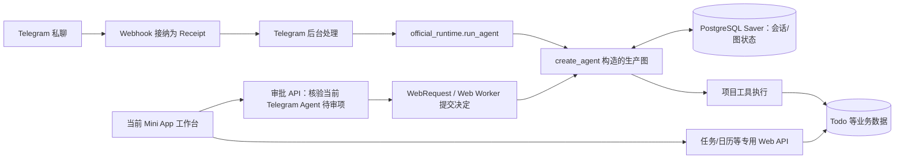
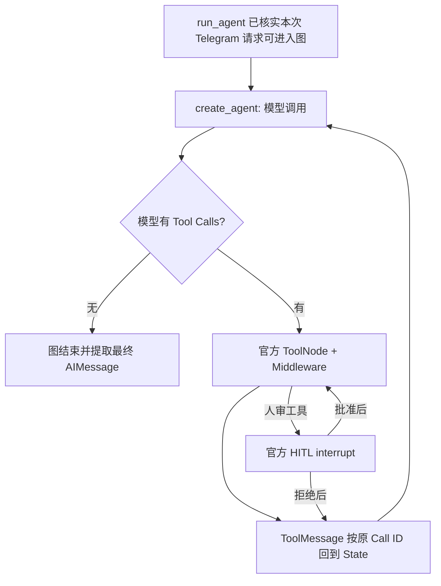
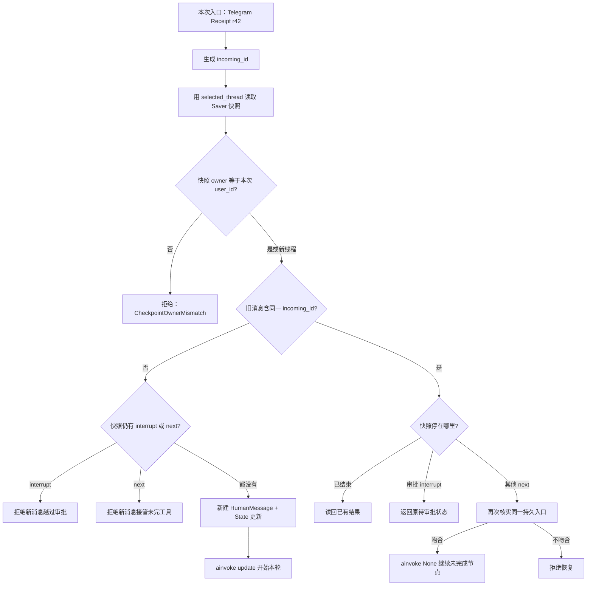
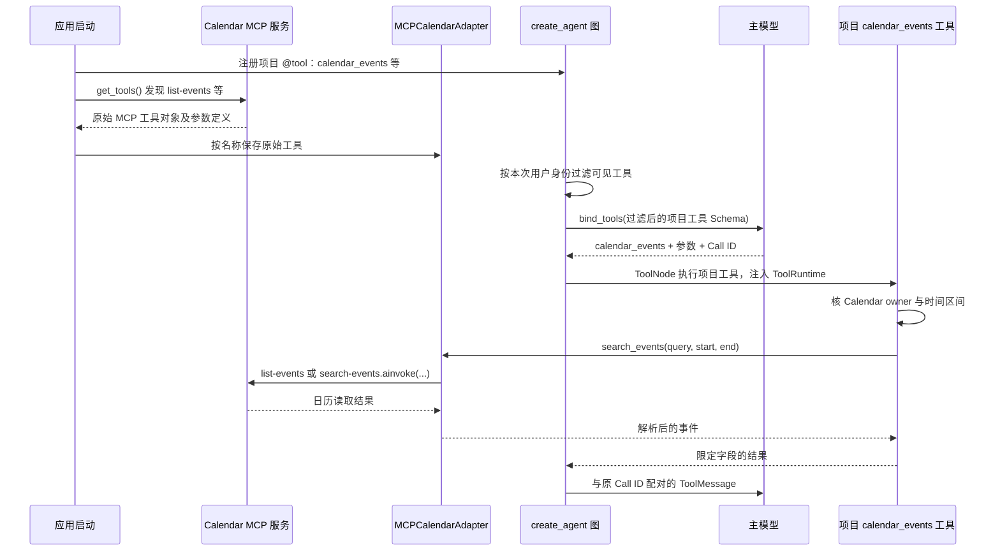
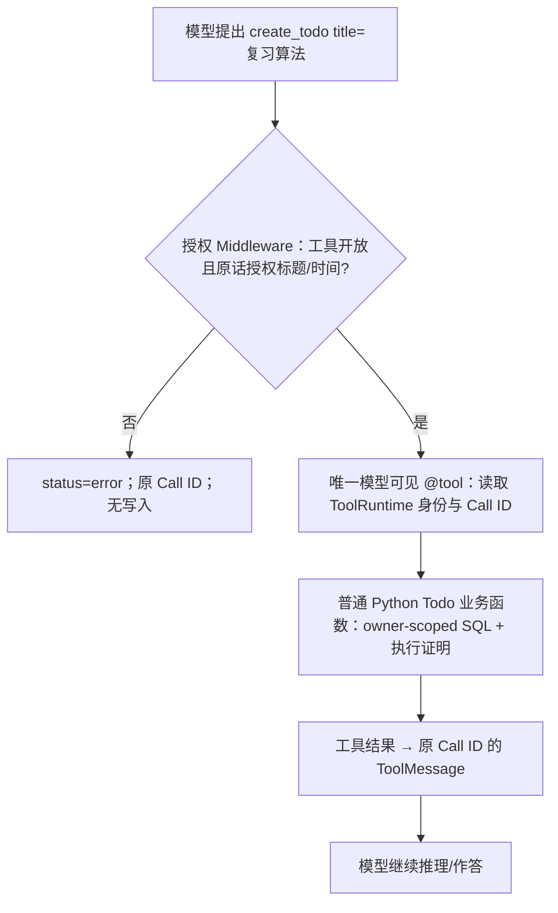
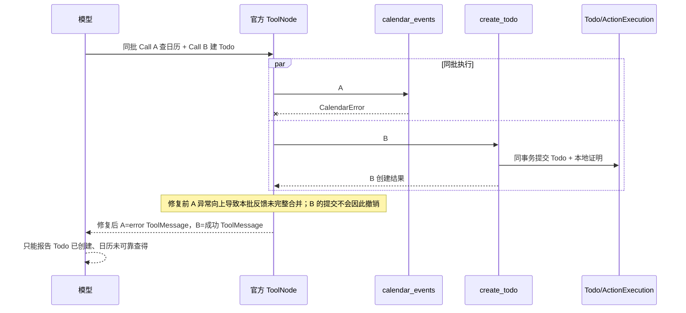

# 第 01 章｜模型提出工具调用后，程序怎样继续运行

第 00 章跟随一条 Telegram 消息走到了 `run_agent`。当时我们说“模型提出 `create_todo`，Python 执行，结果再给模型”，却没有解释这三个动作怎样连接。本章就放大这一段。读完应能拿着一条真实 Tool Call，指出它由谁产生、谁有权执行、结果怎样回到模型，以及为什么“模型说要调用”不是“事情已经办成”。第 02 章再深入各业务工具的授权，第 03 章处理需要人批准的写入和崩溃恢复。

本章的普通示例是“创建待办『复习算法』，不要设置时间”；复合示例是“列出待办，并查明天的日历”。这两条都会进入**同一个**当前生产 Agent，而不是旧版手写 `unified_loop` 图。

先认清**这个项目实际怎样用**。用户在 Telegram 私聊中向 Agent 发自然语言消息。Telegram 的 Webhook 把平台 Update 接纳为数据库里的 `TelegramInboundReceipt`，后台处理器读取它并调用 `app.agent.official_runtime.run_agent`。当前 Mini App 工作台**没有聊天功能**：任务表单、任务列表和日历页面走各自的 Web API，不调用 `run_agent`。工作台若批准或拒绝一项**来自当前 Telegram Agent 的待审操作**，审批 API 会核验用户、`action_id` 和 Checkpoint 版本，再由 Web Worker 将决定交给这张已暂停的官方图；它不是新开聊天。本章主图只画当前用户实际使用的路径。Receipt 是入口请求记录，不是聊天历史；消息和图位置由 PostgreSQL Saver 按线程保存，Todo 结果另存在业务表。



图里的箭头表示**不同请求可走的分支**，不是一条请求的必经步骤。Telegram 文本进入 `run_agent`；工作台任务表单走专用 API；工作台批准或拒绝当前 Telegram Agent 的待审项时，Web Worker 用 `Command(resume=...)` 恢复原图，不调用 `run_agent` 新增用户发言。身份、目标或版本检查失败时拒绝，不恢复图。

## 1.1 先把一次模型往返想清楚

普通聊天模型通常输入文字、输出文字。带工具的模型还可以输出一个结构化建议，例如下列**教学示意**，不是项目日志原文：

```json
{"name":"create_todo","args":{"title":"复习算法","due_date_str":""},"id":"call_abc"}
```

`name` 是工具名，`args` 是模型填写的参数，`id` 是这次调用的身份。模型**没有**执行 SQL；它只是把建议交给 Agent 运行时。运行时找到相应 Python 工具，执行后生成 `ToolMessage(tool_call_id="call_abc", content="...")`。再把这条结果送进下一次模型调用，模型才能说“已经创建”或“创建失败”。如果工具写入失败，单有上一条 AI 输出不构成成功证据。

这里有四种消息，不妨先用一张表认人：

| 消息 | 谁生成 | 本例里装什么 | 能证明什么 |
| --- | --- | --- | --- |
| `HumanMessage` | 服务端从当前用户输入构造 | “创建待办……”和稳定消息 ID | 本轮用户实际说了什么；不证明已执行 |
| 带 `tool_calls` 的 `AIMessage` | 模型 | `create_todo`、参数、Call ID | 模型提出了操作；不证明已执行 |
| `ToolMessage` | 框架执行工具后或项目 Middleware 拦截后 | 原 Call ID、成功结果或 `status="error"` | 该调用得到何种反馈；写入还要看业务提交证据 |
| 不带 `tool_calls` 的 `AIMessage` | 模型 | 面向用户的最终答复 | 模型如何叙述结果；不等于数据库权威事实 |

多个工具同批出现时，**按 ID 配对，不按文字顺序猜测**。例如模型同批提出 `calendar_events(call_A)` 与 `create_todo(call_B)`，结果必须分别是对应 ID 的 ToolMessage。即使 Todo 数据已经提交，也可能因为同批另一个工具抛错，尚未形成完整的图结果；第 03 章会分析这个真实故障。

## 1.2 谁构造了当前 Agent？

应用启动时，`app/main.py` 建立数据库和运行依赖，然后调用 `app/agent/official_runtime.py` 的 `build_graph(...)`。生产持久模式打开 `AsyncPostgresSaver`，传入 `build_official_agent(...)`。这个函数在 `app/agent/official_graph.py` 中组装工具和 Middleware，最终调用 LangChain 的 `create_agent(model=..., tools=..., state_schema=..., context_schema=..., middleware=..., checkpointer=..., store=...)`。返回的是可 `ainvoke` 的图，不是“模型已经处理了一条消息”。

`create_agent` 在此版本底层使用 LangGraph 图：模型节点拿消息和可见工具 Schema 调用模型；如果模型返回 Tool Calls，官方 `ToolNode` 执行工具，把结果加入消息；再回模型；没有 Tool Calls 才结束。项目没有在这个生产图中维护旧版 `pending_tool_index` 或十次工具预算。`recursion_limit=50` 是图运行的安全上限，**不是**“最多执行 50 个工具”的业务配额，也不能保证多目标一定完整。

对照实际构图函数 `app/agent/official_graph.py::build_official_agent` 最关键的一段：

```python
graph = create_agent(
    model=model, tools=tools, system_prompt=OFFICIAL_PROMPT,
    state_schema=OfficialAgentState, context_schema=AgentRuntimeContext,
    middleware=middleware, checkpointer=checkpointer, store=store)
```

`tools` 是前面工厂组合出的 Python 工具；`state_schema` 指定 Saver 要持久和恢复的图状态形状；`context_schema` 指定每次调用由入口注入、供节点读取的可信运行上下文；`checkpointer` 负责线程状态，`store` 用于跨线程 Profile 等资料。这行只**构造**图，不处理用户消息；真正执行在后面的 `graph.ainvoke(...)`。



这张图**只画已经进入图之后**的模型—工具循环，不试图用一句“原入口重放”代替入口判断。`run_agent` 在图开始前怎样读取 Saver、判断新请求或重试、构造 `HumanMessage`，紧接着在 1.3 用具体值和条件展开。

## 1.3 `run_agent`：查会话、核身份、再启动图

### 先看 Telegram 入口实际传入了什么

Telegram 这一路，`app/telegram/webhook.py` 的 `process_admitted_update` 在处理已接纳的 Receipt 时调用 `run_agent(graph=..., user_id=..., telegram_id=..., chat_id=..., user_message=text, ...)`。在这个持久处理范围内，`current_run()` 能取得**当前 Receipt 的数据库 ID**。Telegram 的 `update_id` 是平台给的更新编号，项目的 Receipt ID 是接纳时生成的数据库主键；两者不要混用。这里的 `user_id` 是项目 `users` 表里的 owner ID，`telegram_id` 是 Telegram 发送者 ID，`chat_id` 是回复所用聊天 ID；原话在 `user_message` 中。

Telegram 后台处理在 `receipt_scope` 中取得当前 Receipt 的数据库 ID。`run_agent` 用它生成 `incoming_id="telegram-receipt:<Receipt.id>"`，作为本轮 `HumanMessage.id` 和 `active_turn_id`。同一 Receipt 被 Worker 重试，ID 不变；用户再发一条消息会有另一条 Receipt，ID 也不同。这里的 **turn** 指用户这一次发言，不是新建一个会话线程。工作台任务表单不生成这种 Agent 发言，而由 `app/web/todos.py::create_web_todo` 直接处理。

| 本项目的对象 | 示例值（示意） | 谁创建、保存在哪里 | 本章用途 |
| --- | --- | --- | --- |
| Receipt ID | `r42` | Webhook 接纳 Telegram Update 时写入业务数据库 | 指认一条可重试的入站请求 |
| `incoming_id` | `telegram-receipt:r42` | `run_agent` 根据当前 Receipt 生成 | 判断这句用户原话是否已进入图 |
| `thread_id` | `official-v1:user_10001` | 服务端按 Telegram 用户选择，传给 Saver | 找到这个会话的快照；**不是授权凭证** |
| `user_id` | `u7` | 服务端身份映射得到 | 与旧快照 owner 比较，并约束业务查询 |
| Tool Call ID | `call_abc` | 模型产生 | 把一次工具建议与结果消息配对 |

### State 更新到底是什么

本项目的 **State** 是图在一个线程中保存的运行数据，最重要的是 `messages` 列表；它不是 `todos` 表，也不是把整个数据库送给模型。`OfficialAgentState` 在 `app/agent/official_graph.py` 定义了本项目加在框架 AgentState 上的字段；`state_schema=OfficialAgentState` 让图知道这些字段。**State 更新**就是入口交给图的一份 Python 字典，告诉它“这轮新增什么、重置什么”，而非执行一条 SQL `UPDATE`。框架按 State 的合并规则更新消息等字段，并通过 Saver 保存可恢复的快照。旧消息本来就随线程保存在 Saver 中，服务端只为**新轮**新建一条 `HumanMessage`，不会把旧消息拼成一条新用户发言。

假设用户第一次在 Telegram 发“创建待办：复习算法”，`run_agent` 的关键语句（`app/agent/official_runtime.py::run_agent`）可读成：

```python
incoming = HumanMessage(id=incoming_id, content=user_message, ...)
update = {
    "messages": [incoming],
    "active_request": user_message,
    "active_turn_id": incoming_id,
    "request_origin": "telegram",
    "conversation_thread_id": selected_thread,
    "memory_history_threads": [],
    "memory_context_payload": "",
    "memory_context_prepared": False,
}
if not existing:
    update.update(user_id=user_id, telegram_id=telegram_id, chat_id=chat_id)
result = await graph.ainvoke(update, config=config, context=context)
```

这是**摘取关键语句的教学版**：真实代码在首次进入新版线程时还可能先核 owner 并迁入受限制的最近历史，不是每轮都迁移。不要把这份字典想成“创建一个新会话”：`config.configurable.thread_id` 已经选定 Saver 中的会话位置，`update` 只是这一次准备加入该会话的数据。

| 本次 `update` 字段 | 本例的值从哪来 | 当前项目用它做什么 |
| --- | --- | --- |
| `messages: [incoming]` | `run_agent` 把本次 Telegram 文本构造成 `HumanMessage(id="telegram-receipt:r42", content="创建待办：复习算法")` | 加入会话消息；以后在 Saver 里按这条消息的 ID 判断同一 Receipt 是否已经进过图 |
| `active_request` | 本次用户原话，不是模型生成的参数 | `official_todo_tools` 等写入工具核对“用户到底要求了什么”，例如是否允许创建 Todo、是否授权时间 |
| `active_turn_id` | 与这条 `HumanMessage.id` 相同，即 `telegram-receipt:r42` | 标记当前是哪一轮，供 Profile/记忆处理防止同轮重复；**`run_agent` 判断重放直接比的是消息 ID，不是只看这个字段** |
| `request_origin` | 本次可信入口传入的 `telegram` | `require_agent_runtime_identity` 与本次 `Runtime.context.origin` 比较，防止恢复时入口身份和旧 State 不符 |
| `conversation_thread_id` | `official_thread_id("user_10001")` 得到的 `official-v1:user_10001` | 留在 State 中供本线程的上下文与历史来源处理；Saver 查找本身使用的是 `config.configurable.thread_id`，两处在本例指同一线程 |
| `memory_history_threads` 与 `memory_context_...` | 服务端限定历史范围，并在新轮重置临时装配标记 | 后续上下文装配只在允许的历史范围取证，不复用上一轮的临时证据 |

第一次进入这个线程，还把服务端确认的 `user_id/telegram_id/chat_id` 写进 State；下一轮取回旧 State 时先核 `user_id`，不靠模型重新填写 owner。`context` 则是**本次调用新提供**的可信身份，恢复图也必须重新传入；项目把它与 State 的身份字段比较。于是三件事不同：`config.thread_id` 指向哪个 Saver 会话，State 记录这个会话里发生了什么，`Runtime.context` 证明这一次是谁来调用。代码保存相同信息的地方各有用途，不是让模型在工具参数中选择用户。

### 它怎样认出“旧请求重试”或“新请求撞上未完成节点”

`graph.aget_state(config)` 在调用模型**之前**按 `thread_id` 读取 Saver 快照。快照的 `values` 是已保存的 State；`next` 表示图下一步还有节点要运行（例如工具批次未完成）；`interrupts` 表示当前有等待人工决定的中断。这三者不是同一个字段。函数先比较 `snapshot.values["user_id"]` 与本次入口确认的 `user_id`，不同就抛 `CheckpointOwnerMismatch`。再检查旧 `messages` 中是否已有 `id == incoming_id` 的 `HumanMessage`；**有才叫这里的 `replay`**。它不是凭文本相同判断：同一用户连续两天发相同一句话，有不同 Receipt ID，属于两次新请求。

用同一用户的一次具体事故演算，而不是记“重放”这个词。设该用户的会话键是 `official-v1:user_10001`：

1. 第一条 Telegram 消息被接纳为 Receipt `r42`。`run_agent` 算出 `incoming_id=telegram-receipt:r42`，按会话键读 Saver。若旧消息里没有此 ID，且当前没有待审批或未完节点，就创建上面的 `HumanMessage` 和 `update`，调用 `graph.ainvoke(update, ...)`。
2. Worker 在这条请求处理途中失败，**同一条** Receipt `r42` 被重试。会话键不变，`incoming_id` 也仍是 `telegram-receipt:r42`。若 Saver 消息已有这个 ID，代码算出 `replay=True`。若 `snapshot.next` 有待继续的节点且 `snapshot.interrupts` 为空，确认当前确在原 Receipt 处理范围后调用 `graph.ainvoke(None, ...)`：`None` 表示**不再添加用户消息，从已存位置续跑**。
3. 用户另外发了新消息，形成 Receipt `r43`。即便文字完全相同，新的 `incoming_id=telegram-receipt:r43` 在旧消息中找不到，`replay=False`。若旧图仍待审批，当前 Telegram Webhook 会**先于 `run_agent`**识别到这不是原消息，回复“请先使用原审批按钮或工作台处理”；`run_agent` 里的 `AgentApprovalPending` 是再一层防线。若没有审批中断、但旧图的 `snapshot.next` 仍有未完节点，新消息若到达 `run_agent` 会遇到 `IncompleteAgentTurnRequiresOriginalIngress`。它不能接管 `r42` 的审批或工具节点。
4. 若重试 `r42` 时图正等待人工审批，`run_agent` 只返回旧 interrupt，不会替用户点批准，也不会重添原话。真正的批准/拒绝来自另一条经过身份和目标核验的按钮请求，详见第 03 章。

因此识别依据不是“请求文字相同”，也不是只看 `thread_id`；是**同一持久 Receipt 导出的消息 ID**，再结合 Saver 的 `interrupts`/`next` 判断图停在哪里。若同一个 Receipt 的图已结束，则直接读回旧结果，不再运行工具。

这里还必须分清**“新 Receipt 尚未被领取”与“新 Receipt 已被拒绝处理”**，否则会误以为任何被挡住的消息都会在上一轮结束后自动补做。`app/telegram/durable.py::claim_receipt` 对同一图线程按接纳顺序领取：只要更早的 Receipt 还不是 `PROCESSED` 或 `DEAD`，较新的 Receipt 就保持待领取；恢复扫描日后会再尝试领取它。若早一条请求最终正常完成并标为 `PROCESSED`，后面那条才有机会开始自己的 Agent 轮次。

但“图等待人审批”和“Receipt 仍在处理”不是一回事。原消息产生审批卡片、回复意图持久化后，原 Receipt 可以标为 `PROCESSED`，而图的审批 interrupt 仍在等待按钮。此时新文本 Receipt 能被领取；`app/telegram/webhook.py::process_admitted_update` 发现**新消息 ID 不属于原待审轮**，给用户回复“请先使用原审批按钮或工作台处理”，并把这条新 Receipt 作为**没有业务执行**的已处理请求结束。用户以后批准原审批，也**不会自动重放这条已结束的新文本**；若还要办它，必须重新发送。若原 Receipt 不是待审批，而是工具节点出错且一直未完成，它优先重试；较新 Receipt 通常先被同线程的领取顺序挡住。原 Receipt 若终止为 `DEAD`、Saver 却仍有未完节点，较新 Receipt 即使获领取也会被 `run_agent` 拒绝，并按 Receipt 失败规则重试，不保证日后自动执行。

为什么不直接把后发的普通文本留在 `RECEIVED`，等用户审批完再执行？当前 `claim_receipt` 对**同一线程所有 Telegram Update**按接纳顺序领取，按钮点击本身也是一条新的 Update。如果文字 Receipt `r43` 留在 `RECEIVED`、等待 `r42` 的审批，而用户随后点击按钮形成 `r44`，领取规则会让更晚的 `r44` 被 `r43` 挡住：`r43` 等按钮，按钮又等 `r43`，形成死锁。当前实现选择把 `r43` 明确回复为“本次未执行，请先处理审批”，而不是暗中保留为待办。更友好的“审批完成后自动接续 r43”并非不可能，但需要**让审批回调越过待处理的普通文本**并保证之后按序恢复；现有三种 Receipt 状态本身不会自动完成这种调度。本章只陈述当前行为，不把它说成理想用户体验。

| Saver 快照与本轮 ID | `run_agent` 实际行为 | 为什么 |
| --- | --- | --- |
| 无旧快照，或旧图已结束且没有本轮消息 ID | 新建 `HumanMessage`，调用 `ainvoke(update, ...)` | 这是新发言；旧会话消息由 Saver 接续 |
| 已有本轮消息 ID，图已结束（`next`、`interrupts` 都空） | 读回已有结果，不再追加原话或重跑工具 | 同一持久请求的回放不能变成第二轮 |
| 已有本轮消息 ID，仍有审批 `interrupts` | 返回原待审批状态；不替用户作决定 | 批准/拒绝须经独立审批入口 |
| 已有本轮消息 ID，`next` 非空且没有审批中断 | 再核验原持久入口，才调用 `ainvoke(None, ...)` 续跑 | 可能停在工具结果尚未完整保存的窗口 |
| **没有**本轮消息 ID，却有审批中断 | Telegram Webhook 先提示完成原审批；若仍直接进入 `run_agent`，它抛 `AgentApprovalPending` | 新消息不能越过旧审批，且不会在批准后自动补做 |
| **没有**本轮消息 ID，`next` 非空且无审批中断 | 抛 `IncompleteAgentTurnRequiresOriginalIngress` | 新消息不能接管旧工具批次 |

“再核验原持久入口”在本章 Telegram 路径的具体含义是：要在当前 `receipt_scope` 中拿到 Receipt，旧消息 ID 必须与本次由它生成的 `incoming_id` 相同。这里的 `ainvoke(None)` 不是给模型一条空消息，而是让框架从这个线程已保存的下一节点继续；已提交写入还需要业务执行证明保证重放不会多写一行，详见第 03 章。**仅知道线程 ID 不足以通过这些检查。**

读源码时还会看到 `if origin == "web" and not turn_id: raise ValueError(...)`。这是 `run_agent` 为**后端 Web 聊天 API 分支**保留的保护，不表示当前 Mini App 有聊天界面：这类请求没有 Telegram Receipt，就必须由接纳它的 `WebRequest` 提供稳定的 `turn_id="web-request:<请求ID>"`。若每次重试改用随机 ID，旧 `HumanMessage.id` 就匹配不上，服务端无法分清原请求重试和新请求。当前用户从工作台表单创建 Todo 不进入这个分支。



最后，图返回后 `run_agent` 从消息里选最后一条有内容且没有 Tool Calls 的 `AIMessage` 作为答复；这是**取模型答复**，不是验证 Todo 成功。它还尝试把本轮消息投影到可检索的 Transcript；投影出错会记警告，不意味着已提交 Todo 自动回滚。

## 1.4 工具怎样出现在模型面前，又怎样被执行端把关？

### 先分清两份名字都叫“tools”的列表

本项目有两种来源不同、用途不同的工具，不能用一句“从 MCP 拿到工具，放进 Agent”概括：

1. `app/agent/official_graph.py::build_official_agent` 调用 `make_official_todo_tools`、`make_official_read_tools` 和危险操作工具工厂，组成传给 `create_agent(tools=...)` 的**项目工具列表**。普通 Todo 工具在 `app/agent/official_todo_tools.py` 以显式 `@tool` 函数声明，例如 `create_todo(title, description, ..., time_source_quote, runtime: ToolRuntime[AgentRuntimeContext])`。Calendar 的模型入口也由本项目分别定义：`calendar_events`、`calendar_availability`、`calendar_candidate_slots`、`calendar_event`，以及独立的复合工具 `prepare_meeting`；危险写入则是不同的 `propose_calendar_create/update/delete`。**不是把所有 Calendar 功能合成一个模型工具。**函数的名称、说明和可由模型填写的参数形成模型工具 Schema；`ToolRuntime` 是执行时由框架注入的运行信息，不让模型在工具 JSON 中自填可信 `user_id`。当前生产 Todo 工具明确列出对模型开放的参数，不再靠旧版重建“受限 Schema”的包装方式。
2. `app/agent/calendar.py::discover_calendar_tools` 向 Google Calendar MCP 服务**发现另一份工具列表**，其中的名字是 `list-events`、`search-events`、`get-freebusy` 等。它们保存在 `MCPCalendarAdapter` 内，供项目 Calendar 工具执行时调用。**这份原始 MCP 列表没有直接传进主图的 `create_agent(tools=...)`，模型不直接选择 `list-events`，也不自行填写其底层 `calendarId` 等参数。**

**适配器（Adapter）**是项目中的一个普通 Python 对象，提供 `search_events(...)`、`availability(...)` 等项目稳定接口；它把这些调用翻译成底层服务的工具名、参数，整理返回值和错误。它不是另一个模型，也不是主模型看见的一个“万能工具”。例如用户问“明天有什么安排”，模型可能提出项目工具 `calendar_events(query="", start=..., end=...)`。项目工具先核验当前用户能否读 Calendar、时间区间是否合法，再向适配器传参；适配器因 `query` 为空选择 MCP 的 `list-events`。这是两次不同的“选工具”：**模型选项目工具**，**项目代码选底层 MCP 工具**。模型要是没有生成 `calendar_events` 调用，MCP 服务本身不会主动替它查日历。

### 从 MCP 发现到模型看到工具，按真实启动与执行顺序走一遍

应用启动时，`app/main.py` 先构造当前 `create_agent` 图，随后调用 `app/agent/workflow_runtime.py::build_productivity_runtime` 初始化 Calendar 适配器。虽然后一个函数仍构造历史兼容对象，**当前主 Agent 用的是前一个官方图**；这里相关的是它保存的 Calendar 适配器，不是把旧图拿来执行本轮对话。

若配置启用了 Calendar，`discover_calendar_tools(settings)` 用 `MultiServerMCPClient` 以 `stdio` 方式启动固定版本的 Google Calendar MCP 服务（`@cocal/google-calendar-mcp@2.7.0`），将配置的 OAuth 凭据文件路径传给该进程，并执行 `client.get_tools()`。这里“发现”指取得服务实际公布的工具对象及其参数定义，不代表已调用 Google 读取日程。函数核查若干必需工具名称和关键参数；发现失败或配置关闭时，`build_productivity_runtime` 存入 `UnavailableCalendarAdapter`，后续 Calendar 调用会明确失败，Todo/普通对话不必随之停止。

发现成功后，`MCPCalendarAdapter.__init__` 将这些工具按名称保存为字典：`self.tools = {tool.name: tool for tool in tools}`。另一边，主图构造时 `make_official_read_tools` 已创建项目自己的 `@tool calendar_events`、`calendar_availability`、`calendar_event` 等，`build_official_agent` 把它们与 Todo 等工具组成传给 `create_agent` 的列表。项目工具在**实际执行时**通过 `get_calendar_adapter()` 取前面保存的适配器，因此主图不需要直接持有那份原始 MCP 列表。

每次进入模型节点前，`OfficialToolAuthorization.awrap_model_call` 从本次可信身份、State owner 和配置算出允许的工具名称，过滤 `request.tools`。安装版 LangChain 的 `create_agent` 实现随后把过滤后的 `request.tools` 交给 `model.bind_tools(...)`，模型才看见这些项目工具的名称、说明及参数 Schema。这里是**每次模型调用前重新过滤可见列表**，不是每轮重新启动 MCP 服务或重新 `get_tools()`。用户身份既不能由模型伪造，也不能仅凭模型没看到某工具就省掉执行端校验。

模型若返回 `calendar_events` Tool Call，官方 ToolNode 执行该项目工具。`app/agent/official_read_tools.py::calendar_events` 从 `ToolRuntime` 取得本次身份，调用 `require_calendar_owner` 和 `_interval`，然后调用 `get_calendar_adapter().search_events(query[:200], start, end)`。适配器用 `_call("search-events", payload)` 或 `_call("list-events", payload)` 找到已发现的 MCP 工具并 `await tool.ainvoke(args)`；解析返回的 JSON，项目工具再只取最多 20 条事件的 `id/summary/start/end/status` 给模型。最终 ToolMessage 使用**模型那次 `calendar_events` 的原 Call ID**，而不是底层 MCP 的工具名作为配对依据。若查询失败，本项目的定向错误处理中间件只对指定的只读 Calendar 工具处理 `CalendarError`，返回原 Call ID 的错误消息；它不能把失败说成“日历为空”。



上图只对应**日历事件列表读取**，并不表示所有 Calendar 功能都压缩成一项工具。当前各项分别对应：`calendar_events` 经适配器调用 MCP 的 `search-events/list-events`；`calendar_availability` 调 MCP 的 `get-freebusy`；`calendar_candidate_slots` 取得忙闲后由项目代码计算候选时段；按准确事件 ID 读取的 `calendar_event` 走适配器内部的条件式 Google Calendar 传输。批准后的事件创建会调用 MCP 的 `create-event`，带版本条件的更新、删除使用项目的条件式 Google API 通道；**不是每项日历操作都经过 MCP**。Gmail 则通过独立的 `OAuthGmailSource`，不能把它也说成“发现 MCP 工具”。这里的 MCP 是项目与 Calendar 工具服务交互的协议/适配方式，Tool Calling 是**模型向主图提出项目工具调用**的机制；二者处在不同层。

### 模型看见，不等于有权执行

可见性和执行许可又是两层：`OfficialToolAuthorization.awrap_model_call` 先从 `Runtime.context` 与 State 校验身份，用 `available_tools(...)` 算出该用户可见工具，再 `request.override(tools=...)` 缩小送给模型的 Schema。模型通常看不到无权用的 Calendar/Gmail 工具。但不能把“看不到”当安全边界：`awrap_tool_call` 在真正调用时再检查工具名，并对普通 Todo 创建标题与时间来源做执行前授权；确定拒绝返回原 Call ID 的错误 `ToolMessage`。进入业务工具后还会核可信身份和业务对象的 owner；**Todo 原话授权位于 Middleware，不是又在内层 LangChain 工具重复做一遍**。模型提示、Schema、执行端校验各有作用，后两者不能由提示代替。

`AgentMiddleware` 可以把代码插在模型调用前后、工具调用周围。当前图装配权限、Context、官方 HITL、**指定只读 Calendar/Gmail/网页搜索异常**的错误处理、危险操作预检；不再装配 `TodoToolBoundary`。Todo 创建意图和时间来源现在由 `OfficialToolAuthorization.awrap_tool_call` 在工具执行前检查，确定拒绝时直接形成配对的错误 ToolMessage。`OfficialContextMiddleware` 仅对**这次模型请求**选择最近消息、加入当前时间、Profile 和来源证据；Saver 中完整消息不会因此被裁掉。它的 `abefore_model` 还可能写入明确的 Profile 更新。中间件不是另起一张 Agent 图；它们在官方图的模型/工具生命周期里运行。需要注意：源码列表顺序表示装配顺序，不应未经框架核实就把每个异步 hook 的调用顺序想象成简单的“一行接一行”。

两道权限关都在 `app/agent/official_permissions.py::OfficialToolAuthorization`。下面是**摘取关键判断的教学示意**，其中工具执行前除工具名外还要核对普通 Todo 的创建标题和时间授权：

```python
async def awrap_model_call(self, request, handler):
    allowed = self._allowed(request.state, request.runtime)
    return await handler(request.override(
        tools=[tool for tool in request.tools if tool.name in allowed]))

async def awrap_tool_call(self, request, handler):
    if request.tool_call["name"] not in self._allowed(request.state, request.runtime):
        return ToolMessage(..., tool_call_id=request.tool_call["id"], status="error")
    # create_todo: _todo_create_authorized(active_request, args["title"])
    # 若有时间字段: _todo_time_authorized(active_request, args["time_source_quote"])
    # 不获授权则返回同一 Call ID 的 status="error"，不调用 handler
    return await handler(request)
```

第一段改变的是**模型本轮看到什么**，第二段检查的是**实际执行这一次 Call 时还允不允许**；注释和省略号表示省略了源码的完整错误分支，不是可运行代码。`_allowed` 从服务端身份、State owner 和配置算可用名称，不从模型回答中获取用户身份。标题和时间引文虽由模型提出，授权判断必须回看本轮 `active_request`，不能只相信工具参数。



这里的“一层”指只有**一个模型可见的 LangChain `@tool`**，不是没有下层业务函数。以前外层 `@tool` 再调用内层 `@tool.ainvoke(...)`；现在外层工具把可信 `user_id` 和 `ToolRuntime.tool_call_id` 直接传给 `make_todo_operations` 返回的普通函数。业务函数仍负责时间解析、owner 限定、SQL 和本地重放证明。`OfficialToolAuthorization` 对明确的授权拒绝给模型一个配对的错误结果；它**不**把所有异常都转成“未执行”。如果数据库提交是否发生尚不确定，泛化捕获可能诱导模型再次写入，制造重复副作用。

## 1.5 多工具、并发与顺序：一个真实陷阱

当模型一次返回多个 Tool Calls，安装版 LangGraph 的 `ToolNode._afunc` 使用 `asyncio.gather` 调度本批调用（本机 `.venv/Lib/site-packages/langgraph/prebuilt/tool_node.py`）。所以在“查日历，同时建 Todo”中，不能凭文字里的“先”假设这一批按生成顺序串行执行。明确依赖必须让模型先取得前项 `ToolMessage`，**下一次模型调用**再产生后项；即使把本批工具的执行并发数设为 1，也不会让模型已经写好的第二个 Call 自动吸收第一个工具的结果。

当前生产 `OFFICIAL_PROMPT` 因此增加了一条**模型行为规则**（`app/agent/official_context.py::TOOL_ORDERING_RULE`）：用户明确说“先 A 后 B”，或 B 需要 A 的返回事实时，只调用 A，等 A 的 ToolMessage 到达后再决定 B；仅独立任务可同批调用；A 失败时不能盲做依赖的 B。`OfficialContextMiddleware.awrap_model_call` 将该提示词放进本次模型收到的 SystemMessage。这是引导而不是执行端的依赖调度器，`ToolNode` 仍允许同批并发，不能保证模型每次服从。历史新版 Evaluation 的 OA02 暴露过顺序风险；加入提示词**不等于 OA02 已被完整生产图重新验收并解决**。

为什么仍值得记录这条小改动？`experiments/official_agent_eval_20261020/prompt_order_probe_20261022/` 保存了固定案例和两种模型的配对原始轨迹。当前 QUASAR 模型在一条已知“先查日历，再建 Todo”的**合成工具开发案例**里，原 Prompt 同批发出两个 Call，追加规则后分两轮；另一条邮件依赖案例两组本来都分轮。换一个局域网 Qwen 模型，同一规则在第一个案例没有改善。成功的一组还多一次模型调用和输入 Token。它不是隔离 PG 完整业务图的独立保留集，更不是稳定成功率；项目没有为此加 Planner 或自动补做机制。

同批并发还有另一种危险：兄弟工具 A 已提交，B 抛出未处理异常。本项目的 OA11 原始 Trace 中，`create_todo` 已提交一行，而 `calendar_events` 抛 `CalendarError`，当时 ToolNode 整批未形成完整 ToolMessage 更新，用户也没有最终回复。当前 `ToolErrorMiddleware` 对**指定普通只读工具的已知异常**生成 `status="error"`、保留原 Call ID 的消息：包括 Calendar 的 `CalendarError`、Gmail 的 `GmailError` 和网页搜索的已知只读异常；错误内容表明未取得可靠结果。这样其他已成功工具的消息能正常回到模型。它不处理任意异常，更不替危险写入断言“肯定未执行”。



图中的“同时”是调度语义，不承诺两个外部操作精确同一时刻完成；`asyncio.gather` 一个异常也不等于兄弟协程的已提交事务会自动回滚。修复 OA11 的另一部分——同持久入口恢复“提交后、ToolMessage 前”的窗口——属于第 03 章的 Saver/业务事务问题，不能说 `ToolErrorMiddleware` 自己解决了幂等。

## 1.6 官方能力与项目能力，不要讲反

| 问题 | 框架提供 | 项目补充或限制 |
| --- | --- | --- |
| 模型—工具循环 | `create_agent` 图与 ToolNode，消息合并和继续调用 | 生产入口、工具集、Prompt；不再手写逐项游标 |
| Call/Result 配对 | `ToolMessage.tool_call_id` 协议和 ToolNode | Middleware 拒绝时也要用原 ID；业务成功另查数据库 |
| 同批工具 | ToolNode 可并发 | 生产 Prompt 引导依赖操作分轮；当前仍无执行端的通用顺序保证，需用轨迹核实 |
| 身份注入 | `context_schema`、`Runtime.context`、`ToolRuntime` | 入口可信身份、State owner 对照、具体业务 owner 查询 |
| 模型前后控制 | Middleware hooks | 工具可见性、Context 证据、有限错误语义、危险提案预检 |
| 持久会话 | LangGraph checkpointer | PostgreSQL Saver 的部署、入口重放身份和业务账本 |

回看 1.4 的日历例子：MCP 是 Calendar 服务与项目适配器之间的工具接口，Tool Calling 则是主模型向 Agent 图提出 `calendar_events` 请求；本项目**没有把发现的原始 MCP 工具直接交给主模型**。Gmail 使用单独的 OAuth 数据源，不走上述 Calendar MCP 发现过程。因此不能说“模型直接调用 Google”或“项目实现了通用 MCP Server”。`prepare_meeting` 是一个普通复合工具：内部收集证据和生成草稿，返回结果后主 Agent 还能继续其它目标；它不是第二个主 Agent，也不因待审核草稿而强迫主图结束。深入业务留到第 02 章。

## 1.7 证据、局限和读码练习

现有证据有不同层级：`tests/test_official_tool_normalization.py` 检查 Todo 模型 Schema 不含 `user_id/tool_call_id`、`ToolRuntime` 的身份与 Call ID 被传进普通业务函数，并以合成模型确认生产图的 SystemMessage 确实包含新增顺序规则；`experiments/official_agent_migration_20261020/test_official_read_tools.py` 检查模型可见的 `calendar_events` Schema 不含 `user_id/runtime`，并测试错误 owner 在到达适配器前被拒绝；`experiments/official_agent_migration_20261020/FINAL_LIVE_ACCEPTANCE_20261020.md` 记录真实 Telegram 中 Todo 创建、Todo＋Calendar 只读、多源读取及会议草稿的工具 ID 配对；`tests/integration/postgres/test_pg_official_oa11.py` 用隔离 PG 故障注入验证 OA11 部分提交和恢复；`experiments/official_agent_eval_20261020/OA11_FIX_RESULTS_20261021.md` 保存修复前后 Trace。上述旧 PG/联调记录在此次文档更新中没有重跑。提示词配对的合成工具轨迹见 `prompt_order_probe_20261022/`，不能混成业务终态验收。真实联调不是生产流量统计；一次跨域通过也不证明多目标稳定成功。OA02 的显式顺序风险和 OA14 的日历遗漏/错误回复仍须在各自证据范围内报告。

亲自读码时可依次打开 `app/agent/official_runtime.py::run_agent`、`app/agent/official_graph.py::build_official_agent`、`app/agent/official_permissions.py::OfficialToolAuthorization`、`app/agent/official_todo_tools.py::make_official_todo_tools`。对“复习算法”在纸上写出五个不同 ID/身份，并回答：若模型生成调用但工具返回拒绝，下一次模型究竟看见什么？若同批另一读取失败，哪一种证据才说明 Todo 是否真正提交？

精选面经索引：I01、I02、I03、I04、I05、I07、R01、R03。本章不要求背这些题；能从图和源码自行推导答案，才算读懂。
