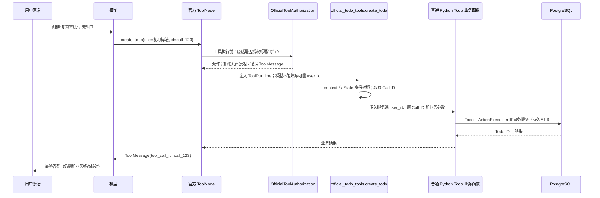
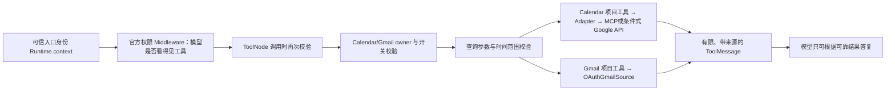

# 第 02 章｜工具能做什么，谁有权让它做

第 01 章说明模型怎样提出 Tool Call、官方图怎样把结果送回模型。本章换一个角度：模型如果把工具名、目标或时间写错了，**哪一层会阻止错误成为真实业务变化？** 我们沿三个场景读当前生产代码：普通 Todo 创建、Calendar/Gmail 读取、需要批准的危险写入。第 03 章再进入审批和执行账本的持久化细节。

先记住一个原则：工具 Schema 帮模型填写参数，Prompt 帮模型理解请求，但它们都不是用户授权。业务授权必须由服务端掌握的身份、当前用户原话、owner-scoped 数据和执行时的目标状态共同决定。

## 2.1 从“创建不带时间的 Todo”追到数据库

用户说“创建待办『复习算法』，不设置时间”。在官方图中，`app/agent/official_graph.py::build_official_agent` 调用 `make_official_todo_tools(session_factory)` 取得六个显式模型工具：`create_todo`、`list_todos`、`update_todo`、`search_todos`、`set_reminder`、`cancel_reminder`。`session_factory` 是创建 SQLAlchemy 数据库会话的工厂，不是另一组 Tool 对象。以前这里是**外层 `@tool` 再调用内层 Todo `@tool.ainvoke(...)`**；现在模型只看 `app/agent/official_todo_tools.py` 中的一层 `@tool`，它调用 `app/agent/tools.py::make_todo_operations` 返回的**普通 Python 业务函数**。这就是“工具合为一层”的准确范围：业务函数和数据库层没有消失，旧动态重建 `user_id` Schema 的包装也不是当前生产路径。

模型可能提出：

```json
{"name":"create_todo","args":{"title":"复习算法","due_date_str":"","planned_start_str":"","reminder_at_str":""},"id":"call_123"}
```

模型的 Call 到达官方 ToolNode 后，**项目的 `OfficialToolAuthorization.awrap_tool_call` 先检查，再允许真正的 `create_todo` 运行**。它从 State 读取本轮用户原话 `active_request`，从模型 Tool Call 读取标题，调用 `_todo_create_authorized(request, title)` 判断原话是否正向授权创建**这个标题**；若模型捏造标题，或者用户只说“不要创建待办”，Middleware 返回同一 Call ID、`status="error"` 的 ToolMessage，不调用工具。本例没有时间字段，所以不进入时间来源判断。准许后，框架注入 `ToolRuntime`；`trusted_request(runtime)` 把本次 `Runtime.context` 的服务端 `user_id` 与 Saver State 中的 `user_id` 对照，并要求 `active_request` 存在。模型无法自报一个 `user_id`。最后 `invoke("create_todo", runtime, ...)` 把可信 `user_id` 和 `runtime.tool_call_id` 传给**普通业务函数**。这里 Middleware 的授权判断与工具的可信身份读取各有职责，不是连续套两个模型工具。

关键判断横跨两处代码；下面是按执行顺序摘出的教学版，不是一个函数的逐字全文：

```python
# official_permissions.py：工具执行前
if call["name"] == "create_todo":
    title = args.get("title")
    if not isinstance(title, str) or not _todo_create_authorized(original_request, title):
        reason = "TodoCreationNotAuthorized"
    elif any(args.get(field) for field in time_fields):
        if not _todo_time_authorized(original_request, args.get("time_source_quote")):
            reason = "TodoTimeNotAuthorized"
if reason is not None:
    return ToolMessage(..., tool_call_id=call["id"], status="error")

# official_todo_tools.py：只有通过前检才运行
user_id = require_agent_runtime_identity(runtime.state, runtime)["user_id"]
args["tool_call_id"] = runtime.tool_call_id
return await operations["create_todo"](**args, user_id=user_id)
```

其中 `time_fields` 和省略号是为教学压缩的记号；实际代码还核对请求与参数类型，`update_todo`、`set_reminder` 也有对应时间分支。执行顺序是：**Middleware 先问这次调用是否获准**，工具再读取可信身份和 Call ID，业务函数最后处理 SQL。没有时间字段时不触发时间校验。这并不是从 ToolMessage 或模型语气里推测“用户应该同意”。

`app/agent/tools.py::make_todo_operations` 内的普通 `create_todo` 解析日期/计划窗/提醒时间，打开 SQLAlchemy 异步会话，`crud.create_todo(...)` 建立 `Todo(user_id=..., title=...)`。在持久 Telegram Receipt 或 WebRequest 中，调用 `commit_todo_tool_operation` 把业务 Todo 与一条本地 `ActionExecution` 重放证明放在同一数据库事务提交；它不会因为模型给了新 Call ID 就跳过授权。提交结果沿普通函数返回模型可见工具，由 ToolNode 形成与 `call_123` 配对的 ToolMessage，模型下一轮才能引用它。**消息接纳、Tool Call、业务提交、ToolMessage、最终答复仍是五个不同事件。**



上图的事务括号是**持久 Telegram/Web 入站**路径；没有相应入口上下文时，`commit_todo_tool_operation` 的普通分支直接执行并提交，不应谎称所有脚本或单测调用也有相同重放保护。第 03 章会解释同一张 `action_executions` 表怎样容纳不同来源的操作。

## 2.2 Todo 的四种时间不是同一个字段

“明天 17:00 处理”与“明天截止”“明天 16:50 提醒我”表达不同承诺。`app/db/models.py::Todo` 分别保存 `due_date`（截止）、`planned_start_at`/`planned_end_at`（计划处理时间窗）、`reminder_at`（通知时刻），另有 `status`（待办或完成）和 `version`（用于目标版本约束）。Todo 不带时间时这些时间列为空，不能把相邻日历会议时间擅自填进来。

当前模型可见工具提供 `time_source_quote`：模型若填写任一时间字段，要把**用户针对这个 Todo 说过的时间原话**复制过来。`OfficialToolAuthorization.awrap_tool_call` 在执行工具前检查是否填写时间；有则调用 `app/agent/unified_tools.py::_todo_time_authorized(request, source_quote)`。函数要求引文实际出现在当前原话、包含时间或排期措辞，并按任务片段判断这段话是否属于 Todo 目标；单独会议或日历目标里的时间不得借给 Todo。`update_todo`、`set_reminder` 同样检查相应时间变更。模型没有给出可信来源时，服务端拒绝，而不是“尽量猜一个时间”。

注意 `time_source_quote` **不是**可信授权令牌：它由模型填写，必须由服务端回到 `active_request` 逐字寻找，再按子目标判断。模型写“明天 16:30”但用户只把它说给另一个会议，字符串虽然出现过，仍不足以授权 Todo 排期。这是来源校验，而非对模型“引用了原话”就无条件相信。

| 用户原话 | 模型提出 | 服务端应如何看待 |
| --- | --- | --- |
| “创建待办 A，不设时间；明天 16:30 有会议” | A 的 `planned_start_str=明天 16:30` | 时间来自另一个目标，拒绝该时间化调用 |
| “创建待办 A，明天 17:00 处理” | A 的计划开始及准确 `time_source_quote` | 原话属于 A，可进入普通业务函数的时间解析与业务校验 |
| “帮 A 智能排期，先查空闲” | 先读日历，后设置 A 的计划窗 | 用户授权排期，但仍需证据和正确顺序；不是随便取会议时间 |
| “创建待办 A，不设时间” | A 无时间参数 | 可正常创建，时间列保持空 |

`_todo_time_authorized` 是保守的字符串/片段来源校验，不是完美的中文语义理解器。模糊的复合句可能被拒绝，需要澄清；不能把“有校验”宣传成能理解所有时间指令。更重要的是，它校验**授权来源**，普通 Todo 业务函数随后还负责**解析值**，两者不能互相代替。`app/agent/tools.py::make_todo_operations` 内的 `create_todo` 会用 `parse_datetime` 解析，拒绝无法解析或已过的提醒；它还会根据明确的带时刻截止或提醒推导计划开始。这是当前真实业务语义，若面试官问“为何日历上出现计划块”，要沿实际字段与同步功能查证，不能只说时间校验通过就等于 Google 已同步。

## 2.3 为什么“只读，不创建待办”曾是安全漏洞

当模型错误地在只读请求里提出 `create_todo`，服务端不能指望模型自己纠错。此前 `_todo_create_authorized` 对短否定“不创建”有漏判，OA11 额外诊断触发了非预期 Todo 行。当前函数先要求拟创建的 `title` 非空、且出现在用户原话中，再按标点和“但”切分子句，识别否定创建、单纯讨论、正向创建。混合请求“不创建 A，只创建 B”不能因出现一个“不”就全部拒绝，也不能拿 B 的正向意图授权 A；若无法清楚归属，拒绝。

```mermaid
flowchart TD
    A[模型提出 create_todo(title=X)] --> B{X 是否在当前用户原话里?}
    B -->|否| R[Middleware 返回原 Call ID 的错误 ToolMessage；无写入]
    B -->|是| C{有正向创建子句?}
    C -->|否| R
    C -->|是| D{有否定创建子句?}
    D -->|无| E[再检查时间来源和 owner]
    D -->|有| F{正向子句明确指向 X 且否定子句不指向 X?}
    F -->|否/不清楚| R
    F -->|是| E
    E --> G[进入业务写入]
```

这只是服务端防线的一部分：中文表达多样，正则不应包装为通用“意图识别框架”。验证时必须**主动构造错误 Tool Call**，否则模型恰好没犯错无法证明边界有效。`experiments/official_agent_eval_20261020/TODO_NEGATION_AND_TELEGRAM_RECEIPT_RECOVERY_20261021.md` 与对应隔离 PG 测试记录了修复前后、合法复数创建和混合标题的反例。不能把这类安全回归计入“多目标成功率提升”。

## 2.4 Calendar/Gmail 只读工具从哪里读，能读谁的？

当前注册的读取工具在 `app/agent/official_read_tools.py`。`calendar_events(query,start,end,runtime)` 先用 `require_agent_runtime_identity` 对照本次 `Runtime.context` 和 State，接着 `require_calendar_owner(telegram_id)` 要求配置已启用且当前 Telegram ID 是 Calendar owner；`_interval` 要求 ISO 时间有时区、终点晚于起点且不超允许跨度；然后 `get_calendar_adapter().search_events(...)` 向配置的日历适配器取真实结果，并裁成有限的 `id/summary/start/end/status` 列表。它不是在本地凭空生成日历。`calendar_availability` 读空闲/忙碌，并在供应方没有可信 busy 列表或报告错误时抛 `CalendarError`，不能把失败说成“全天空闲”。

这里**适配器（Adapter）**不是模型能调用的某个工具，而是项目内部统一日历接口的 Python 对象。模型可见的日历工具有多项，不是把全部 Calendar 功能包装成一个工具：`calendar_events` 列事件，`calendar_availability` 查忙闲，`calendar_candidate_slots` 结合忙闲计算候选时间，`calendar_event` 按准确 ID 读一个事件；另有 `prepare_meeting` 复合工具，以及须审批的 `propose_calendar_create/update/delete`。主图只注册这些项目工具，**不直接注册 MCP 服务的原始工具**。启动时 `discover_calendar_tools` 从本机 Google Calendar MCP 子进程取得 `search-events`、`list-events`、`get-freebusy` 等工具对象，`MCPCalendarAdapter` 按名称保存；项目工具真正执行时才调用适配器，适配器的 `_call(name,args)` 才执行相应 MCP 工具的 `ainvoke`。例如 `calendar_events(query="") → search_events(...) → MCP list-events`；`calendar_availability → availability(...) → MCP get-freebusy`。这解释了“模型看到项目工具”与“底层确实使用 MCP 工具”如何同时成立。并非所有日历操作最终都走 MCP：`calendar_event` 精确读取及带版本条件的更新、删除使用适配器内的条件式 Google API 通道；批准后的事件创建使用 MCP 的 `create-event`。这些路径见 `app/agent/calendar.py::MCPCalendarAdapter`、`app/agent/official_read_tools.py` 和审批后的 Calendar 协调器。

`gmail_search`、`gmail_unread`、`gmail_thread` 同样先检查 Gmail owner，再由 `get_gmail_source()` 取授权邮箱来源；没有来源就报不可用。搜索查询长度和返回数量有边界，`_email_evidence` 只给有限的发件人、标题、时间、摘要、正文片段。邮件内容是**低信任证据**，不是新的系统指令。`gmail_unread` 最多返回五封；由五条结果不能推出“全邮箱恰好五封未读”。



`app/agent/unified_tools.py::available_tools` 是当前官方权限 Middleware 复用的可见性规则；`require_calendar_owner` / `require_gmail_owner` 则是工具函数内部的**独立**执行前检查。可见性防止不相关工具诱导模型调用，执行校验防止模型或图状态异常绕过权限。适配器不可用、OAuth 失效、供应商超时与“确实没有日程/邮件”必须分别报告。

以日历为例，工具内不是只查一个布尔开关（`app/agent/unified_tools.py:274-293`）：

```python
if (not settings.google_calendar_enabled or
        not settings.google_calendar_owner_telegram_id or
        telegram_id != settings.google_calendar_owner_telegram_id):
    raise PermissionError("CalendarOwnerMismatch")
```

其中 `telegram_id` 来自可信 `ToolRuntime.context`，不是模型填写的 `event_id` 或 `query`。即使模型设法提出了一个本不该可见的 Calendar Call，业务工具仍应在这里拒绝。

## 2.5 读取失败和危险写入不能共用一句“工具报错”

`app/agent/official_graph.py` 只把**指定只读工具的已知异常**纳入 `ToolErrorMiddleware`：四个 Calendar 读取工具的 `CalendarError`、三个 Gmail 读取工具的 `GmailError`，以及网页搜索的已知只读错误，由 `_read_tool_error` 返回各自的安全文案。框架据此产生原 Call ID、`status="error"` 的 ToolMessage，模型有机会继续其它独立目标并说明读取失败。它不应泄露内部堆栈或凭据，也不应把失败转成空列表；未知异常和写入结果不确定不能被无差别转成普通错误。

写入则不同：如果远端 Calendar 创建请求已经发出，本地却超时，结果可能是**未确认**，不是“确定失败、可以再创建”。因此危险操作由 `propose_calendar_create/update/delete` 等工具先做预检，交官方 HITL 审批，再用项目的 ActionExecutor/Calendar 协调器执行和对账；OA11 的定向读错误 Middleware 不兜住这些写入。`PermissionError`、版本冲突等也保留各自安全语义。

普通 Todo 删除也是危险提案。模型可以调用 `propose_todo_delete(target=...)`，但 `AllGuardedPreflight` 的 Todo 分支通过 `prepare_todo_delete(session_factory,user_id,target)` 先在**当前 owner** 的列表里要求唯一匹配，再冻结准确 `todo_id`、标题和 `version` 到 `ActionProposal`。标题、短 ID、完整 ID 的输入形式最后都要落到同一个准确目标；不能让用户批准“A”而执行时模型偷偷换成“B”。对同一请求里已经拒绝的准确目标，预检会阻止重复提案。只有准备成功的调用才进入官方审批；批准后还要重查版本和 owner。第 03 章会沿这条链继续读。

Gmail 引导的创建也不是“读到邮件就可写”：`verified_email_source` 要求授权线程里恰有该消息且引文确实存在，`prepare_email_todo`/`prepare_email_calendar` 再形成提案并等待人批准。`prepare_meeting(event_id)` 则是**普通复合工具**：严格定位已授权的 Calendar 事件，内部收集来源证据、调用受限结构化模型、校验并保存待审核草稿；它的完成是“草稿待审核”，不等于批准外部写入，也不应让主 Agent 提前 END。

| 工具类别 | 典型工具 | 模型能直接引发的结果 | 更强的项目约束 |
| --- | --- | --- | --- |
| 当前用户 Todo 普通操作 | `create_todo`、`update_todo` | 满足授权后可本地提交 | State/context owner、当前原话、时间来源、业务 owner 查询、持久入口重放证明 |
| 外部只读 | `calendar_events`、`gmail_search` | 取得有限证据；不会写 Google | 账号开关/owner、参数边界、来源不可用与空结果区分 |
| 危险写入提案 | `propose_todo_delete`、`propose_calendar_create` | 只到预检/待审批，不立即执行 | 精确目标与版本/时段、官方 HITL、批准后再校验 |
| 会前草稿 | `prepare_meeting` | 创建本地待审核草稿 | Calendar/Gmail/Todo 来源核验、结构化生成与字段验证；内容审核独立于危险操作审批 |

## 2.6 框架与项目各做了什么，怎样验证

LangChain 的 `@tool`/ToolRuntime、`create_agent`/ToolNode、Middleware 扩展点负责工具协议和运行时注入；PostgreSQL/SQLAlchemy负责持久字段与事务原语。项目自己决定**谁是当前业务用户**、哪些工具可见、具体 owner/参数/时间/来源约束、危险操作何时需批准，以及适配器错误应如何解释。仅说“LangChain 提供权限系统”不准确；框架提供插口，业务策略仍由项目实现。

可核查路径：`app/agent/official_graph.py` 的当前工具注册；`app/agent/official_permissions.py` 的执行前检查；`app/agent/official_todo_tools.py` 的唯一模型可见 Todo 工具层；`app/agent/tools.py::make_todo_operations` 的普通业务函数；`app/agent/calendar.py` 的 MCP 发现与适配器；`app/agent/official_read_tools.py`、`app/agent/official_guarded_tools.py`、`app/db/models.py::Todo`。`tests/test_official_tool_normalization.py` 检查工具 Schema、可信身份/Call ID 传递和授权拒绝；隔离 PostgreSQL 与 Fake Adapter 回归主要见 `tests/integration/postgres/test_pg_official_oa11.py` 及 `experiments/official_agent_migration_20261020/test_official_read_tools.py`、`test_official_permissions.py`；真实 Telegram 联调范围见 `FINAL_LIVE_ACCEPTANCE_20261020.md`。本次文档更新没有重跑真实 Google；既往受控只读/写入验收不能证明所有账号、供应商故障与并发都已验证。

建议做一次读码练习：把“不要创建 A，只创建 B；明天 16:30 有会议”分别代入 `create_todo(title=A)`、`create_todo(title=B, planned_start_str=明天16:30)`、`calendar_events(...)`。在纸上写出每条调用会经过哪一层、是否进入 SQL/Google，以及哪一种 ToolMessage 才能支持最终答复。不要只看模型有没有说“遵守要求”。

精选面经索引：I02、I03、I06、I10、R01、R02。第 03 章接着回答：人批准后谁真正执行，崩溃重来为什么不会重复删。
