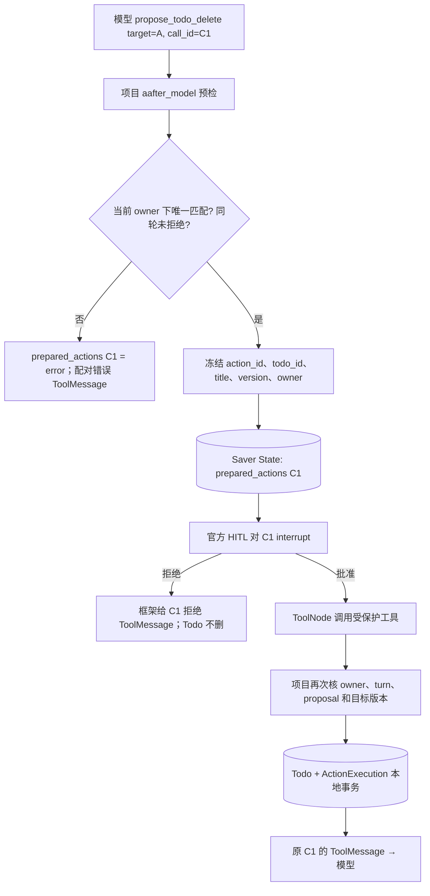
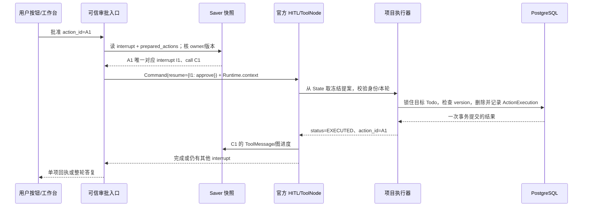
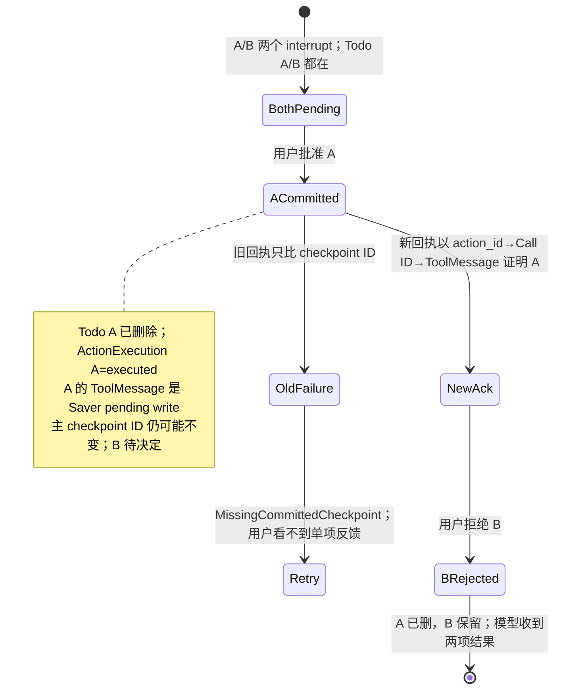
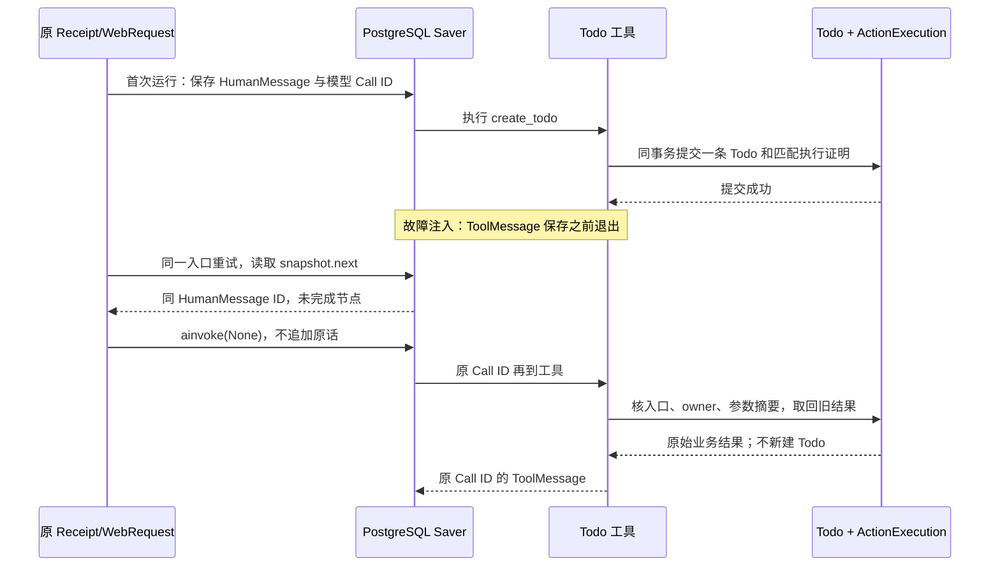

# 第 03 章｜人批准之后，怎样安全地执行与恢复

第 02 章停在 `propose_todo_delete`：模型提出删除，项目已经锁定当前用户的一条准确 Todo，但还没有删。本章跟随“删除待办 A”进入审批、数据库事务、图恢复，再跟随同一轮 A/B 双审批的真实事故看清：**业务已提交、工具结果已持久、主 Checkpoint 尚未前进、Telegram 尚未回执**可以同时成立。另一个 OA11 故障窗口则相反：业务已提交、ToolMessage 尚未保存。两种窗口的恢复证明不同，不能用一句“有 Checkpointer 就幂等”概括。

## 3.1 最少的四个概念

**人工审批（HITL）**不是模型问一句“可以吗”，而是执行流在危险工具前暂停；真实用户通过 Telegram 按钮或 Web 工作台给出决定，再由服务端带着这一决定恢复同一张图。当前图使用 LangChain `HumanInTheLoopMiddleware`，而不是旧版手写 `agent_approval_gate` 作为生产控制节点。

**Checkpoint/Saver** 是 LangGraph 保存图 State 和下一步执行位置的机制。State 中有消息、当前请求、已准备提案等；Saver 能按 `thread_id` 找回它。Checkpoint 是图进度记录，**不是 Todo 业务事务记录**。同一批工具部分完成时，LangGraph 还可能有已持久化的 **pending write**：一个工具的输出可在 `graph.aget_state` 中看到，主 Checkpoint ID 暂时没变。这个细节正是本项目真实双审批故障的核心。

**事务**是 PostgreSQL 的“这几项本地变化一起提交或一起回滚”。对本地 Todo 删除，项目让 Todo 删除和 `ActionExecution` 结果在一次提交里完成。**行锁**是在事务中锁定目标 Todo 行，防止另一事务在检查版本与删除之间改变它；**唯一键**阻止两个并发执行者都为同一个 `action_id` 建立新执行记录。它们解决数据库内的并发，不自动保证 Google 或 Telegram 端到端恰好一次。

**幂等**在这里不是“用户可以随便重发删除请求”，而是**同一被证明的执行身份重试时不得重复产生副作用**。一个新用户请求会形成新的身份，仍需重新审批。图状态、业务执行账本和消息入站身份要一起看。

## 3.2 从 Tool Call 到待审提案：审批前绝不删除

模型提出 `propose_todo_delete(target="A")`，官方图在模型返回后调用 `app/agent/official_todo_approval.py::TodoApprovalPreflight.aafter_model`。它从 State 找最新带 Tool Calls 的 `AIMessage`，用 `require_agent_runtime_identity` 校验本次 `Runtime.context` 与 State 中的 owner、Telegram/chat/来源一致；再取本轮 HumanMessage ID。对于每个 Todo 删除 Call，它调用 `app/agent/unified_tools.py::prepare_todo_delete(session_factory,user_id,target)`。该函数只读当前用户的 Todo，要求目标名、完整 ID 或前缀**唯一匹配**；返回 `ActionProposal`，里面固定 `action_id`、owner、准确 `todo_id`、标题、`approved_todo_version` 和给人看的说明。这里不会执行 `db.delete`。

预检结果以 `prepared_actions[tool_call_id]` 保存进图 State。这个字段是项目为框架审批阶段和后续工具执行阶段之间保留的最小交接数据；它不是第二张任务规划表。若目标不唯一，或同一轮已拒绝/已提过同一个准确 Todo，保存错误而不是再向用户索要批准。`AllGuardedPreflight` 对 Calendar/Gmail 来源写入也准备相应准确提案。随后 `HumanInTheLoopMiddleware` 的 `when=needs_todo_review` 只对存在有效提案的 Call 中断，`description=todo_review_description` 用提案的人类可读说明展示操作。当前生产配置为 `interrupt_mode="per_call"`，一个批次中两项危险调用可以各自有审批决定。

源码中的交接点很明确（`app/agent/official_todo_approval.py:45-60,73-116`）：

```python
def needs_todo_review(request) -> bool:
    if _already_answered(request.state, request.tool_call["id"]):
        return False
    return bool(_prepared(request.state, request.tool_call["id"]).get("proposal"))

# aafter_model 的有效提案分支，摘取核心赋值：
old[call["id"]] = {
    "turn_id": turn, "target_key": target_key,
    "proposal": proposal.model_dump(mode="json")}
```

框架的 `when` 看的是**这个 Call ID 对应的预检记录**，不是所有 `propose_*` 名字一律停下来要求批准。预检失败只返回错误工具结果，避免用户批准一个实际上没有准确目标的操作。



这张图刻意分开**提案**、**用户决定**与**执行**。审批卡片显示的标题来自已验证提案，不是模型最后随口说的文字；执行时工具从 `prepared_actions` 取提案，不拿模型再次生成的一套新参数。Calendar 创建还有执行前的时段再验证，Calendar 更新/删除会绑定外部事件版本；用户批准旧版本不应覆盖已经变化的目标。

## 3.3 用户点按钮后，谁把决定送回同一张图？

Telegram callback 到达 `app/telegram/webhook.py`。它先由持久入站和用户映射取得真实身份，读取当前官方 Saver 快照。`app/agent/official_approval_view.py::pending_official_approvals(snapshot,user_id)` 检查 State owner；从 interrupt、`prepared_actions` 和已有 ToolMessages 中投影**仍待处理**的审批。即便 LangGraph 在批内部分恢复后仍在快照里保留一个已解决 interrupt，只要原 Call ID 已有 ToolMessage，UI 不应再把它当待审项。

`official_decision_for_action` 将**业务 `action_id`** 唯一映射到一个官方 **interrupt ID**，只接受 `approve`/`reject`，可对照预期 Checkpoint ID 防止过期决定。Telegram 路径把映射结果交 `Command(resume={interrupt_id:{"type":"approve"}})` 恢复图；Web 工作台在 `app/web/runs.py` 由已持久化的 WebRequest Worker 执行同一类恢复，并在 Saver 元数据写入请求归属标记。审批“编辑”在当前官方路径不是直接把编辑文本传给危险工具：Web 代码明确拒绝 `OfficialApprovalEditRequiresNewRequest`，需要取消/拒绝后由用户发新明确请求。

批准后，官方 ToolNode 调 `make_approved_todo_delete_tool` 产生的工具。它再次取 `prepared_actions`，核对提案操作、本轮 ID 和 `Runtime.context` 的身份，调用 `execute_approved_proposal(proposal,identity)`。这个函数在 `app/agent/agent_approval.py`；它验证提案 owner 与本次用户一致、此操作必须审批，并对 Calendar/Gmail owner 和日历空闲作执行前检查，再交 `ActionExecutor.execute`。`ActionExecutor` 是业务执行器，不是另一个 Agent：本地 Todo 删除走 `delete_todo_atomically`；Calendar 写入走相应协调器，处理远端结果不确定性。执行结果被包装成与**原** Tool Call ID 对齐的 ToolMessage，明确 `EXECUTED`、`FAILED` 或 `UNCONFIRMED` 的含义。模型随后才能如实生成最终回复；待其他审批时图仍处于中断，不应宣称整轮已结束。



这里有三种身份，不要混淆：`interrupt ID` 指这一次图中断，`Tool Call ID` 把工具结果配回模型调用，`action_id` 识别项目业务提案/执行。审批入口从用户点击的 `action_id` 找准确 interrupt；业务层再用 `action_id` 防重复执行。单用 Checkpoint ID 既不能代替用户认证，也不能证明某一项业务已经提交。

## 3.4 本地事务到底保证到哪一步？

看 `app/agent/executor.py::SqlAlchemyActionLedger.delete_todo_atomically`：它先按 `action_id` 查已有 `ActionExecution`，命中则返回旧结果；否则插入同 ID 的执行行并 `flush()`，让主键唯一约束挡住竞争者。然后 `select(Todo).where(Todo.id==已批准的 todo_id, Todo.user_id==已确认的 user_id).with_for_update()` 锁定准确行，比较当前 `Todo.version` 与提案冻结的 `approved_todo_version`。若目标消失或版本变化，在账本中记 `FAILED`，不删除；若仍一致，删除 Todo，把结果设 `EXECUTED`，同一次 `db.commit()` 提交**删除与证明**。冲突方捕获唯一键冲突后读取已存在的执行记录，而不是重新删另一个 Todo。按标签批量删除还冻结准确 ID 集和逐条版本。

最关键的 SQLAlchemy 片段在 `app/agent/executor.py:122-157`：

```python
todo = await db.scalar(select(Todo).where(
    Todo.id == proposal.args["todo_id"],
    Todo.user_id == proposal.args["user_id"]).with_for_update())
approved_version = proposal.args.get("approved_todo_version")
if todo is None or (approved_version is not None and todo.version != approved_version):
    row.status = ActionStatus.FAILED.value
    await db.commit()
    return ActionResult(..., status=ActionStatus.FAILED, ...)
await db.delete(todo)
row.status = ActionStatus.EXECUTED.value
await db.commit()
```

`with_for_update()` 是数据库层锁这条 Todo，不是锁整个用户或所有 Todo；`todo.version` 比的是用户批准时冻结的目标版本。省略号只省去了返回文案与结果字段，不是可直接运行的代码。失败分支会提交失败账本，但不删除业务对象；成功分支把删除和成功账本放入一个本地事务。

| 故障或竞争 | 预期本地结果 | 为什么 |
| --- | --- | --- |
| 用户批准前 | Todo 仍在；该批准执行尚无成功记录 | 预检只准备提案，官方 HITL 阻断工具 |
| 批准后目标被其他请求改过 | Todo 不按旧审批删除；该 action 记失败 | 行锁下重查 owner 和 `version` |
| 同一个 `action_id` 两个执行者竞争 | 一个插入/执行；另一个读既有结果或等待冲突结果 | `ActionExecution.action_id` 主键和事务 |
| 本地事务提交前崩溃 | Todo 删除和成功证明不应出现“只提交一边” | 两者属于同一 PG 提交 |
| 本地事务提交后、Saver/回复之前崩溃 | Todo 已删、账本已执行，图/回复可能尚未完成 | 跨 PG 业务事务与 Saver/消息记录没有一个总事务 |

同表不等于同一种幂等策略。当前 `app/db/models.py::ActionExecution` 是统一的业务执行记录，包含 `action_id`、`user_id`、领域、操作、状态、结果与时间。**批准的危险操作**按提案的 `action_id` 查询，含冻结目标与版本；**Telegram Receipt 下普通 Todo 写入**由 `receipt_id + 原 Tool Call ID + 工具名` 派生短 `action_id`，结果中保存 Receipt 身份和参数 SHA-256；**WebRequest 下普通 Todo 写入**由 `request_id + Call ID + 工具名` 派生 ID，保存参数摘要。`app/telegram/durable.py::commit_todo_tool_operation/_commit_web_todo_operation` 会先核相应 Receipt/WebRequest 的有效租约与 fence，再在 Todo 和执行证明同事务提交。重放时必须逐项核用户、操作、入口身份、参数摘要、终态和原返回文本，缺一则安全拒绝。三类**共用一张表，不代表只查一个任意 ID 就够**：来源身份和参数仍须验证；新请求也不能偷用旧请求的证明。

这套本地证明不能保证远端 Calendar/Telegram exactly-once。远端请求可能已被对方接受而本地超时，必须承认 `UNCONFIRMED`、查询/对账，而不是把超时当肯定没执行后自动重试。第 04 章会进一步解释 Receipt 与 Outbox 的投递边界。

## 3.5 真实事故 A：双审批的“主 Checkpoint 不变”

2026-10-20 的**真实 Telegram 联调**中，用户同轮要求删除两个合成 Todo：A、B 各有独立的 Call ID、`action_id` 和目标版本。批准 A 后，数据库中 A 已删除、`ActionExecution(A)=executed`；B 仍存在且尚待决定。官方逐调用 HITL 允许这批工具局部完成：A 的 ToolMessage 作为 pending write 已持久可在 `aget_state` 中读取，但主 Checkpoint ID 因 B 仍中断而没有前进。

原项目回执逻辑在 `app/telegram/webhook.py::_record_checkpoint_outcome` 假定“审批成功 ⇒ 主 Checkpoint ID 必须前进”，于是报 `MissingCommittedCheckpoint`，不给用户及时反馈。用户以为卡住重复点，出现多次“操作已不再等待审批”。根因是**我们的回执证明选错了图级证据**，不是 LangGraph 丢了 A 的工具结果，也不是用户重复点击导致原始故障。



修复在 `webhook.py::_official_callback_tool_result`：从 `prepared_actions` 中要求该 `action_id` **唯一**对应原 Tool Call ID，然后在 Saver 当前 State 中寻找同 ID 的持久 ToolMessage。若主 Checkpoint ID 未前进但这个证明存在，`_record_checkpoint_outcome` 记录单项 `tool_result`，发送“本项已处理，还有一项待确认”。`_replay_completed_resume` 在同一 callback Receipt 重试时复用该持久结果，**不再次 `Command(resume)`**。B 后续拒绝，则 B 不产生删除执行记录，最终完整结果分别描述 A 已删除、B 未删除。后来一条多审批消息被改为两张各有批准/拒绝按钮的独立卡片，这是用户体验层变更，未改变批准和业务幂等规则。

`app/telegram/webhook.py:103-156` 里的修复核心可缩成两步（下面只保留原源码关键条件）：

```python
calls = [call_id for call_id, item in prepared.items()
         if (item.get("proposal") or {}).get("action_id") == action_id]
if len(calls) != 1:
    return None
message = next((m for m in values.get("messages", ())
                if isinstance(m, ToolMessage) and m.tool_call_id == calls[0]), None)
```

先要求 `action_id` 只匹配**一项**准备好的调用，再用这项的 Call ID 查**已持久化的结果**；不能拿“某个 Todo 不见了”或“账本里有一条 executed”直接证明这次按钮的图结果。当这一证明存在时，后续代码才允许在主 Checkpoint ID 未变的情况下登记 `tool_result`。重试时又查同一结果，不重复喂批准命令。

证据层级要说准确：`experiments/official_agent_eval_20261020/DUAL_APPROVAL_REAL_INCIDENT.md` 和 `experiments/official_agent_migration_20261020/FINAL_LIVE_ACCEPTANCE_20261020.md` 记录真实 Telegram 失败与复测；`experiments/official_agent_migration_20261020/test_per_call_hitl_146.py` 及 `test_official_approval_entry.py` 有框架/回执反例；隔离 PG 验证 pending write 和业务终态。这不是离线 Evaluation 自动发现的“模型优化成果”，更不是大规模并发测试。

## 3.6 故障窗口 B：Todo 已提交，ToolMessage 还没保存

OA11 是不同的窗口。新版 Evaluation 的原始请求让模型同批调用 `calendar_events` 和 `create_todo`。Calendar Fake 抛 `CalendarError`，Todo 已在 PG 提交一行，但旧 ToolNode 整批异常退出：没有完整工具反馈，也没有最终答复。定向 `ToolErrorMiddleware` 修好了“明确只读 Calendar 错误变为错误 ToolMessage”，**并未自动解决**一种更尖锐的崩溃：Todo/`ActionExecution` 已提交，工具还没来得及形成或保存 ToolMessage 时进程退出。

对此 `official_runtime.run_agent` 先看 Saver 中同一 `HumanMessage.id` 是否已存在。如果已存在且 `snapshot.next` 表示节点未完、没有审批 interrupt，**只有原持久 Telegram Receipt 或 WebRequest 身份**可 `graph.ainvoke(None, ...)` 续跑；新的 Receipt 不得接管。重跑到同一 Todo 工具时，`commit_todo_tool_operation` 按原 Tool Call ID、入口身份与参数摘要读出已提交结果，**不再创建**。参数变化或证明缺失则拒绝，不能用“看起来标题一样”冒充同一请求。随后框架可形成原 Call ID 的 ToolMessage，模型才有真实成功反馈。



隔离 PG 的 `tests/integration/postgres/test_pg_official_oa11.py` 在提交后、ToolMessage 前**人为抛错**，分别测 WebRequest 和 Telegram Receipt：重启式重建图并按原入口恢复后，Todo 和 `ActionExecution` 各一条，原 Call ID 配对；不同入口或不同参数不能复用结果。`experiments/official_agent_eval_20261020/OA11_FIX_RESULTS_20261021.md` 保存修复前后真实 Qwen 合成案例。这个测试证明**被注入的精确窗口**，不意味着所有进程崩溃点、外部服务和 Telegram 远端投递都已经达到 exactly-once。

两个故障对照起来最容易记：

| 窗口 | 业务表 | ToolMessage/Saver | 正确恢复依据 |
| --- | --- | --- | --- |
| 双审批 A 已处理、B 待审 | A 已删且账本成功 | A 的 ToolMessage 已作为 pending write 可读；主 checkpoint 未前进 | `action_id` 唯一找到原 Call ID，再查已持久 ToolMessage；同 Receipt 不重复 resume |
| OA11 提交后反馈前 | Todo 已建且账本成功 | 原 ToolMessage 尚无，节点未完 | 同一持久入口 `ainvoke(None)`，原 Call ID + 参数摘要取回旧业务结果 |
| 用户新发一条相似请求 | 旧业务结果可能存在 | 新 HumanMessage/入口身份 | 不是重放；需要重新检查授权，危险操作重新审批 |

## 3.7 取舍、边界与读码路线

框架提供图循环、Saver、`Command(resume)`、逐调用 HITL、ToolNode 和消息协议。项目添加的不是另一套审批图，而是：预检并冻结准确目标；可信身份和版本核验；业务事务与 `ActionExecution`；跨 Saver/Receipt/Outbox 边界的回执证明；外部结果未知时的保守语义。这些都是“工具能执行”之外的业务安全问题。相反，项目仍保留若干历史兼容代码和较复杂的跨入口恢复逻辑，维护成本真实存在；不能为显得高级而说每一层都不可替代。

要练习读码，先看 `app/agent/official_graph.py::build_official_agent` 的 HITL 配置，再看 `app/agent/official_todo_approval.py::aafter_model` 如何生成 `prepared_actions`，接着看 `app/agent/official_approval_view.py` 如何把 `action_id` 映到 interrupt，最后沿 `app/agent/agent_approval.py::execute_approved_proposal` 到 `app/agent/executor.py::delete_todo_atomically`。另一条故障链沿 `app/telegram/webhook.py::_record_checkpoint_outcome/_replay_completed_resume` 和 `app/agent/official_runtime.py::run_agent` 读。请自己推导：A 已删除、B 仍待审批时，为什么“不见新主 Checkpoint”不能让系统再删 A？Todo 已提交但没有 ToolMessage 时，又为什么不能直接回复“完成”而不续跑图？

精选面经索引：I07、I08、I24、I26、R04、R05、R06、R07。下一章才详细讨论 Telegram Webhook、Receipt、Worker、Outbox 的整个消息可靠性链；本章只在其与 Agent 审批和业务提交相交的地方使用它们。
