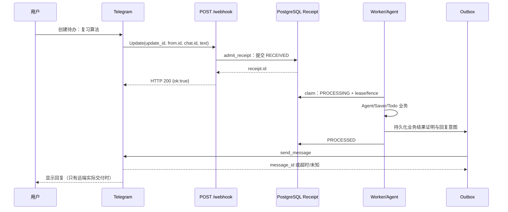
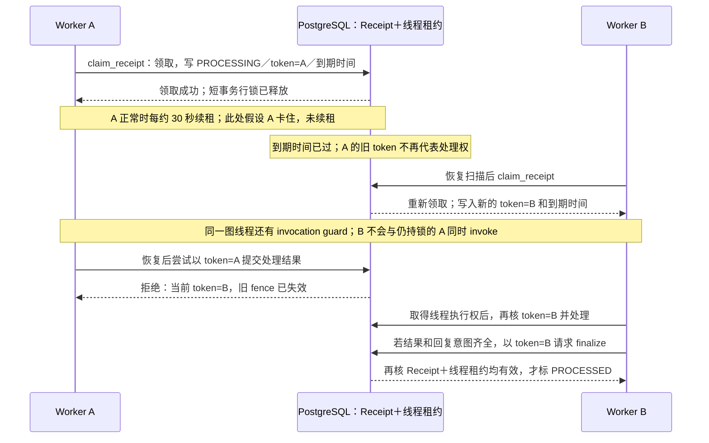
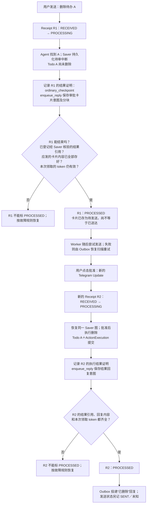

# 第 04 章｜Telegram 消息为什么不能直接交给 Agent 后就算完成

第 03 章解决的是“危险操作批准后，业务怎样只执行一次”。本章把镜头向前、向后各移一步：Telegram 的 HTTP 请求如何进入本地服务；Agent 已经写完 Todo 后，回复又怎样送回用户。我们用“创建待办：复习算法”贯穿普通路径，用真实双审批故障解释为何 **Todo、Saver、Receipt、Outbox** 是四种不同的事实。

## 4.1 一条消息实际上跨越四个完成点

用户在 Telegram 私聊发送文字后，Telegram 服务器向项目公开的 `POST /webhook` 发 JSON。**Webhook** 是“别人发生事件后主动向我们的 HTTP 地址发请求”，不是后台不停向 Telegram 查询。**HTTP 200/ACK** 只表示本次网络请求被接纳；网络连接不能无限等模型、数据库和 Google。Telegram 给每条 Update 一个 `update_id`，消息对象还有发送者 `from.id` 与聊天 `chat.id`：前者识别 Telegram 用户，后者指定回复去哪个聊天。在当前私聊中两者常相同，但含义不同，不能拿 `chat.id` 代替已认证的用户身份。

这张图里的四个“完成”不能互相替换：`RECEIVED` 是接纳；Todo 事务提交是业务事实；Receipt `PROCESSED` 是**该入站 Update 的业务结果及应发送回复意图已持久**；Outbox `SENT` 是 Telegram Bot API 返回了发送结果。`PROCESSED` 可以出现在审批图仍暂停时——原请求已把“请审批”卡片作为本次回复意图存好，未来按钮点击是**新的 Telegram Update、新 Receipt**。它也可以早于真正发出卡片。这不是“用户请求的所有自然语言目标都完成”。

## 4.2 Webhook 接纳：谁给去重 ID，谁负责提交

`app/telegram/webhook.py::telegram_webhook(request)` 是 FastAPI 在 `POST /webhook` 到达时调用的异步路由。它先比较 `X-Telegram-Bot-Api-Secret-Token`，再检查应用与持久接纳运行时是否 ready；否则分别给 403 或 503。随后解析 JSON，进入 `durable.admission_lock` 后再检查一次关闭状态。`app/telegram/durable.py::normalize_update(data)` 要求合法 `update_id`、发送者与聊天 ID，将文字/语音标识或按钮数据缩成可重放的规范化 envelope，并对规范化 JSON 算摘要。它不是把整个不受控原始 Update 永久塞进业务表。

`admit_receipt(session_factory, bot_identity, data, graph_kind, thread_id, ...)` 在短数据库事务中插入 `TelegramInboundReceipt(state="RECEIVED")`。**Receipt ID 是项目生成的 UUID**；Telegram 给的是 `update_id`。去重约束是 `(bot_identity, update_id)`：同一 Bot 的同一 Update 重投，读取原记录，不创建第二份。未脱敏时如果同一键对应不同规范化内容摘要，则拒绝身份冲突。此处 `bot_identity` 是运行时向 Bot API `getMe` 核验的 Bot ID，而不是把 Bot Token 存到表里。提交成功后 Webhook `durable.kick(receipt.id)` 尽快唤醒处理；唤醒失败返回 503，但已提交 Receipt 可由恢复扫描重新找到。[源码：`webhook.py:632–700`、`durable.py:113–208`、`durable_runtime.py:42–64`]

重复 HTTP 投递和项目内重试不同。前者再次执行 `admit_receipt`，应得到**同一个 Receipt**；后者是在已有 Receipt 上重新领取 Worker 租约。用户主动重新发一条文字会有新的 `update_id`，不自动等同于上一次请求。业务写入的防重还需要第 03 章的原 Tool Call ID、入口身份、参数摘要和 `ActionExecution`，不能只靠 Receipt 唯一键。

**Telegram 重投**专指 Telegram 服务器再次向同一个 `/webhook` POST **同一条 Update（同一个 `update_id`）**。例如数据库已提交 Receipt，但服务器回 200 的网络连接断了，Telegram 没确认我们接纳成功，便可能再送同一 Update；应用不可因此新建第二条业务请求。`admit_receipt` 的 `(bot_identity, update_id)` 唯一键让它读回原 Receipt。它不是用户重新发送文字或再次点按钮——那些通常是有新 `update_id` 的新 Update。[`webhook.py:635–700`、`durable.py:175–208`]

## 4.3 Worker 怎样领取，又为什么要有 lease 与 fence

`DurableTelegramRuntime.start()` 先核验 Bot 身份、必需的表，就**立即启动常驻的** `_recover_loop()`；不是等发生错误才启动。只要服务正常运行，它就循环查询数据库、睡约 **5 秒**、再查询：找 `RECEIVED`、重试时间已到的 `FAILED`、租约已过期的 `PROCESSING`，然后尝试 `kick`。新消息提交 Receipt 后，Webhook 也会直接 `kick()` 创建一次 `_process(receipt_id)` 任务，让它不必等下次扫描；恢复循环是这条快速路径遗漏或进程重启时的兜底。这里 `asyncio.create_task` 只是本进程的快速唤醒，真正可恢复性来自 PostgreSQL Receipt，不来自这项内存任务。[`durable_runtime.py:53–86,187–237`]

`_process()` 首先调用 `claim_receipt`。后者给 Receipt 和对应的 Telegram Thread 同时加短事务行锁、领取约 **120 秒的 lease（租约）**、生成随机 **fence_token（栅栏令牌）**，把状态改成 `PROCESSING`，并将 `attempts` 加一。租约说明“谁在一段时间内可以处理”；fence 要求写结果时证明“我仍是这次领取的有效所有者”。心跳每约 30 秒续租；过期的旧 Worker 不能靠已经失效的 token 抢写结果。`claim_receipt` 还检查同一线程是否有更早的未终结 Receipt，避免后来的聊天消息越过前面的未处理请求。[`durable.py:243–293`、`durable_runtime.py:88–112`]

直接看**同一条 Receipt `R1`** 的数据库字段怎样变；下面的 `a1…`、`b2…` 只是截短展示的示例 token，实际值由 `uuid4()` 每次领取时生成：

| 时间 | 实际调用 | `R1.state / attempts` | `R1.fence_token / lease_until` | 结果 |
| --- | --- | --- | --- | --- |
| 12:00:00 | Webhook 提交 `R1` | `RECEIVED / 0` | `NULL / NULL` | 尚无人处理。 |
| 12:00:01 | A 调 `claim_receipt(R1)` | `PROCESSING / 1` | `a1… / 12:02:01` | 函数把新 token 同时写入 Receipt 和该线程的租约行，提交后才把 `a1…` 返回给 A。 |
| 12:00:31 | A 的 `_heartbeat(R1, a1…)` | `PROCESSING / 1` | `a1… / 12:02:31` | 先核两行仍是 `a1…` 且尚未过期，再把两行的到期时间更新为“现在＋120 秒”。 |
| 12:00:40 | A 卡住，心跳停止 | 不变 | 不变 | A 不会因为时钟到了就自动被 Python 杀掉；只是数据库里的处理权会过期。 |
| 约 12:02:35 | 恢复扫描发现 `lease_until <= now`；B 调 `claim_receipt(R1)` | `PROCESSING / 2` | `b2… / 12:04:35` | B 将 Receipt 和线程租约的当前 token 换为 `b2…`。同线程图执行锁仍防止 A、B 同时 invoke。 |
| 随后 | A 醒来，调用 `finalize_receipt(R1, a1…)` | 不变 | 仍是 `b2…` | 因 `a1… != b2…`，返回 `False`；A 不能把这条 Receipt 标为 `PROCESSED`。 |
| B 完成后 | B 调 `finalize_receipt(R1, b2…)` | 可变成 `PROCESSED / 2` | 清空 | **只有**当前 token、两处租约均未过期、业务结果和回复意图均已持久，才会提交 `PROCESSED`。 |

这里“租约有效”的精确定义是：**数据库当前时间尚未达到 `lease_until`**；“fence 有效”是：**调用者持有的 token 等于 Receipt 和线程租约行中的当前 token**。两项都要核对。`claim_receipt` 的短事务行锁只保护领取时的字段修改，不会锁着数据库等待模型两分钟。[`durable.py:243–293,345–368`、`durable_runtime.py:88–112`]

领取成功不等于立即执行 Agent。`_process` 还进入 `thread_invocation_guard` 和 `telegram_workflow_guard`，在同一图线程上防止旧进程和接班进程同时 invoke；取到锁后再次读 Receipt，确认其 fence 仍有效。之后在 `receipt_scope(receipt_id, token)` 下调用 `webhook.process_admitted_update(envelope)`。这个 scope 让下游 Todo 提交时知道“当前是哪一条持久入站请求”，但**用户身份仍需从已验证的 Telegram Update 解析为内部 `user_id`**，并由 Agent Runtime 再核对 State owner。[`durable_runtime.py:114–149`、`webhook.py:705–755,843–880`]

这里的 A、B 是**两次处理尝试**，并不表示当前启动器常驻运行两个 Telegram Worker 进程。当前按需启动器只起一个应用进程；但该进程可为不同 Receipt 建立多个异步 `_process` 任务，重启或租约过期后也会有接班尝试。数据库不是只有一把全局租约：每条处理中 Receipt 有租约，同一图线程另有一行线程租约，不同线程可以分别处理。下面假设 A 处理到一半卡住，心跳也停止；图只画**同一条 Receipt 的领取权转移**，不表示已经提交的 Todo 会随租约过期而撤销：[启动入口：`on_demand_runner.py:300–301`、`run_windows.py:14–15`；任务创建：`durable_runtime.py:81–86`；线程租约：`durable.py:267–285`]

把它想成一张**有截止时间且会换编号的工作证**：`lease_until` 是截止时间，`fence_token` 是本次领取的编号。短暂的数据库行锁只保护“发证／换证”的事务，**不会锁住数据库等模型运行 120 秒**。续租必须在旧证仍有效时进行；提交结果时仅说“我曾经领取过”不够，还要同时满足 Receipt 和线程租约的当前 token、有效期检查。fence 只阻止旧 Worker 冒充当前持有人，**不负责撤销它此前已提交的业务写入**；业务重放还要靠第 03 章的执行证明与幂等约束。[`durable.py:243–293,345–368`、`durable_runtime.py:88–112,127–148`]

### 三种失败，不能统称“五次后死信”

| 情形 | 本项目代码的状态变化 | 下一步 |
| --- | --- | --- |
| `_process` 捕获普通异常且原 fence 有效 | `fail_receipt` 记异常**类型名**到 `failure_category`；`attempts < 5` 为 `FAILED`，固定约 30 秒后可重领；达到默认 5 为 `DEAD` | `_recover_loop` 扫到到期 `FAILED` 再领取。这个 **5 是 `fail_receipt` 的默认参数**，不是所有故障的全局硬上限。 |
| 进程崩溃、任务取消、无机会调用 `fail_receipt` | 可能仍为 `PROCESSING`；租约到期才成为扫描候选 | 过期后重新 `claim_receipt`，`attempts` 在领取时增加。单靠这条路径不能声称一定在第 5 次转 `DEAD`。 |
| `DurableSafetyError` 等保护性异常 | 当前 `_process` 也按异常类型尝试 `fail_receipt`，但异常**不会被当成普通工具错误反馈让模型重试写入** | 必须重新从 Saver/业务证明核实；达到默认异常失败上限可变 `DEAD`，不代表已提交的 Todo 被回滚。 |

这里没有指数退避：`fail_receipt(...retry_after_seconds=30,max_attempts=5)` 计算 `next_attempt_at = now + 30 秒`；首次领取就记一次 attempt。不能从状态名 `DEAD` 反推“所有失败路径都有五次上限”。[源码：`durable_runtime.py:156–175`、`durable.py:371–394`]

## 4.4 什么时候把 Receipt 标成 `PROCESSED`

业务处理可能是普通对话的 Saver Checkpoint、Todo 执行后的工具结果、审批单项结果，或 `/help` 等无业务结果。`enqueue_reply` 要求写入 `outcome_kind/outcome_ref/required_reply_count`，并按 `(receipt_id, reply_ordinal)` 保存不可随意更改的 `OutboundDelivery` 与分块；已有回复若摘要不一致便拒绝重放。`has_complete_outcome_and_intents` 要求合法业务结果证明、完整的序号列表及每条回复至少有一个分块。`finalize_receipt` 再确认 Receipt 和 Thread lease 的 fence 才改 `PROCESSED`。[`durable.py:296–320,345–368,416–472`]

这回答了一个容易误解的问题：为什么删除 A 的请求生成审批卡片后，原 Receipt 可以 `PROCESSED`？因为原 Update 的当前处理结果就是**持久待审状态与通知用户审批的意图**；用户按“批准”会作为另一个 callback Update 被接纳，继续同一个 Saver 图。把原 Receipt 一直占成 `PROCESSING` 直到用户哪天批准，会占住同线程后续输入，还会在等待人的数小时内反复失去 120 秒租约。Receipt 是**入站投递单**，不是整项长期业务目标的状态机。

用“删除待办 A”看两个不同的入站 Update。图中的“回复意图已存”只指 PostgreSQL 已存好**将要发送什么**，不等于 Telegram 已收到：

判断框的三项不是三个新业务步骤：① 上游已查 Saver，并给 R1 登记了可引用的待审图结果；`finalize_receipt` 只核对允许的 `outcome_kind` 和非空引用，不会在这里再执行 Agent。② 若需发一张卡片，数据库应有序号 `0` 的 `OutboundDelivery` 和至少一块文本；两张卡片就要有序号 `0、1` 且都存好，防止只存半套回复就结束。③ Receipt 与同线程租约仍属于当前 token，防止过期 Worker 把它标成完成。

图中 R1、R2 **各自**领取租约、保存结果证明和回复意图、通过 `finalize_receipt`；它们不是把一个 Receipt 从“待审批”挂到“批准完成”。**顺序是先把卡片内容存为待发送、再把 R1 标为 `PROCESSED`、然后尝试向 Telegram 发送**；若发送失败，Outbox 另行恢复。用户点卡片后才产生新的 Update／R2，用同一线程的 Saver 中断恢复图。对于 R2，若同批另有操作尚待审批，结果证明可为该项持久 ToolMessage 对应的 `tool_result`，而非整轮已完成的 Checkpoint。`PROCESSED` 的检查不查询“用户的所有目标是否完成”，也不要求 Outbox 已 `SENT`。[`webhook.py:274–324`、`durable.py:296–320,345–368,416–472`、`durable_runtime.py:149–155`]

## 4.5 Outbox 发送：本地“要发”不等于远端“收到”

`_process` 在 `finalize_receipt` 后调用 `_dispatch_receipt`；恢复循环也扫描 `PROCESSED` 且投递未终结的 Outbox。`claim_next_chunk` 对一个回复分块领取约 45 秒的发送租约，记 `OutboundDeliveryAttempt`，状态变 `SENDING`。`dispatch_delivery` 向 Telegram 发消息；拿到 `message_id` 后 `finish_chunk` 标 `SENT`。若调用报错或本地等待超时，代码标 `UNCERTAIN` 并在默认约 30 秒后考虑重试；`SENDING` 租约过期也先标未知，不能简单判“没发送”。默认分块尝试数为 5，达到后 `EXHAUSTED`。审批卡片若对应 action 已完成，还会避免迟到投递一张已失效卡片。[`durable_runtime.py:177–185,210–226`、`durable.py:475–657,660–691`]

未知态是一个真正的分布式故障：Telegram 可能已收到并显示消息，但本地网络超时没拿到 `message_id`。本项目能证明“发送意图与尝试没有悄悄丢失”，**不能保证 Telegram 用户最终只看到一条**。三个方向不能说反：**Telegram 重投**重新送入站 Update，保护接纳；**Receipt 重试**重新处理已接纳的记录，保护业务处理；**Outbox 重试**重新尝试向 Telegram 发送回复，保护远端投递意图。三者不可互称“端到端 exactly-once”。

## 4.6 用真实双审批事故把四层状态串起来

真实 Telegram 联调里，同轮删除合成 Todo A/B；用户先批准 A，B 还未决定。数据库里 A 已删，`ActionExecution(A)` 为 `executed`；A 对应的 ToolMessage 作为 Saver 的 **pending write** 已持久化，但主 Checkpoint ID 尚未变化。原项目回执逻辑误以为“主 Checkpoint ID 不前进＝A 未执行”，抛 `MissingCommittedCheckpoint`，用户迟迟看不到单项反馈，重复点按钮又收到“该操作不再等待审批”。这是**项目回执证明条件错误**，不是 LangGraph 把 A 撤销了。

修复后的 `webhook.py::_official_callback_tool_result` 用 `action_id` 找到唯一原 Tool Call ID，再在 Saver 中寻找同 ID 的持久 ToolMessage；`_record_checkpoint_outcome` 接受这个单项结果证明。相同 callback Receipt 重试时 `_replay_completed_resume` 复用结果，不能再 `Command(resume)` 执行 A 一次。B 后来拒绝，仍留在 Todo 表；A 只删一次。反例测试、隔离 PG 和真实 Telegram 双审批复测是三种不同级别的证据，不可说成大规模线上 exactly-once。[源码：`webhook.py:91–160,202–274`；记录：`experiments/official_agent_eval_20261020/DUAL_APPROVAL_REAL_INCIDENT.md`、`experiments/official_agent_migration_20261020/FINAL_LIVE_ACCEPTANCE_20261020.md`]

## 4.7 与 WebRequest 的关系、取舍与读码练习

第 07 章会讲 Web。先记住：Mini App 不是 Telegram Webhook；浏览器自己向 `/api/v3/...` 发 HTTP 请求。需要后台执行的 Web 操作创建 **WebRequest/run_id**，也用 Worker、租约和身份校验，但不复用 Telegram `update_id` 或 Receipt。工作台多数 Todo 页面直接调 CRUD API，不等于有一页“Agent 聊天”。两类入口可能在审批时恢复同一个 Agent Saver 线程，所以 Saver owner 与入口证明仍须核对。

这套 PostgreSQL Receipt/Outbox 带来更多表、锁和恢复分支。若只是本机单次脚本，直接 await Agent 更简单；但 Webhook 需要及时 ACK，Bot 的处理和回复又可能跨模型、审批、人为等待与进程重启，因此持久接纳确有用。它不是无限扩容方案，也没有真实高并发压测；换成成熟队列仍须解决业务提交、图恢复和 Telegram 远端未知态。

自己读码时，先沿 `telegram_webhook → admit_receipt → kick/_recover_loop → claim_receipt → process_admitted_update → enqueue_reply → finalize_receipt → dispatch_delivery` 画出每个返回点的数据库状态。然后尝试画出“A 批准、B 待审”和“Telegram 已收到回复但本地超时”的两种非普通路径，不要把 `PROCESSED` 误画为 `SENT`。

面试关联：本章支撑 L4 消息可靠性、L2 审批恢复，精选问答中与 Receipt/Saver/Outbox 对应的 R10–R12。证据边界：真实双审批是少量合成对象联调；重试、租约与故障窗口另由 `tests/test_r4_2_durable_unit.py`、`tests/integration/postgres/test_pg_r4_2_durable_ingress.py`、`tests/integration/postgres/test_pg_durable_runtime.py` 等隔离测试覆盖；本章写作没有重跑它们。
