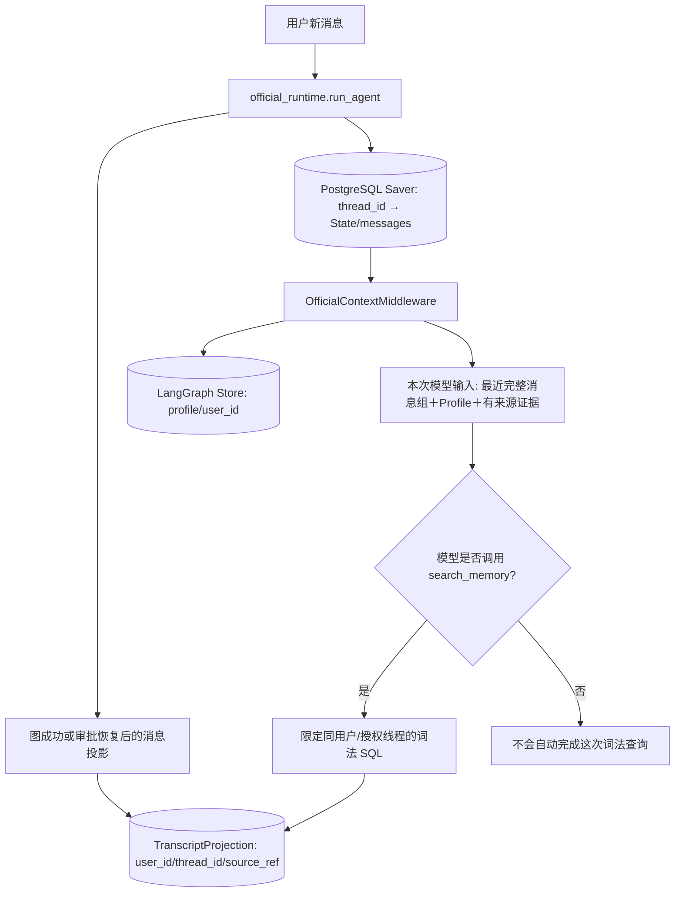

# 第 06 章｜Agent 为什么能记住上一轮，却不一定找得到很久以前的事实

第 05 章要求按“实际证据”判断答复，历史事实也一样：模型说“我记得”不是证据。本章从用户今天说“以后请简洁回复”，明天新开一轮问“按我的偏好解释算法”，再到“上周说的项目版本是多少”这两个不同问题，读懂当前生产路径的三处存储：**Saver 保存图会话；Profile Store 保存有限用户资料；PostgreSQL TranscriptProjection 提供来源可追的词法历史检索**。它们不是同一种 Memory。

## 6.1 先把三个“记住”分开

**当前线程短期上下文**：`run_agent` 按 `thread_id` 从 LangGraph PostgreSQL Saver 读回图 State；`messages` 里是之前的 `HumanMessage`、`AIMessage`、`ToolMessage` 等。它负责对话继续与中断恢复，不等于把所有历史文字都无上限送给模型。

**Profile**：只有项目识别为明确自我介绍或偏好的用户文字，才可能提取成 `profile/<内部 user_id>/user_profile` 的结构化值。LangGraph Store 跨线程按用户读取它；Store 是持久键值接口，既不是当前线程的 Checkpoint，也不是把每句聊天原文原样存成 Profile。当前提取使用项目的有限模式与字段合并，不能说是后台 LangMem 自动语义抽取。[`official_context.py:83–106`、`nodes.py:160–192,226–305,417–433`]

**TranscriptProjection**：来自 Saver 消息的独立 PostgreSQL 查询投影，保存带 owner、thread、message ID、角色、时间、内容与 `source_ref` 的有界文本；用于 `search_memory` 找来源原话。它不是另一份完整的、独立主导会话恢复的 Checkpoint。原始图状态的权威仍在 Saver。普通回复与用户原话可投影，System Prompt、工具消息和带 Tool Call 的 AIMessage 不作为可搜索历史事实。[`transcript.py:50–111`]

## 6.2 一轮请求怎样进入模型输入，而不剪坏 Saver

`app/agent/official_runtime.py::run_agent` 以服务端确认的 `user_id`、Telegram ID/chat ID、原话及 `thread_id` 调图。对于新请求，它创建带稳定本轮 ID 的 `HumanMessage`，把 `active_request`、`active_turn_id`、`conversation_thread_id` 等更新送进图；同一持久入口恢复时不再追加第二份原话。Saver 按线程取回原 State，State 的 owner 必须与本次入口身份一致。[`official_runtime.py:148–247`]

模型不需要也不应该每次读完整的历史。`OfficialContextMiddleware.abefore_model(state,runtime)` 先通过 `require_agent_runtime_identity` 比较可信 `Runtime.context` 与 Checkpoint State owner；需要时处理 Profile 写入和当前轮来源证据装配。`awrap_model_call` 再调用 `select_todo_context(history,max_messages=16)`，只把最近的**完整消息组**与 System Prompt、当地时间、Profile 及有界来源证据放入**本次**模型请求。它没有把 Saver 中的全部旧消息删除；下一次仍可按相同 State 恢复。[`official_context.py:70–150`、`context_protocol.py::select_todo_context`]

为什么要成组？一条带 Tool Call 的 AIMessage 后面应有同 ID 的 ToolMessage。如果只按最后 16 条消息粗暴截断，可能留下“模型调用了工具”却切掉工具返回，或者反过来留下孤立结果，让模型误以为未执行或把结果配错。成组选择是短期 Prompt 的完整性适配；它仍可能舍弃更早用户目标，**不是通用多目标不遗漏保证**。`ContextOrchestrator` 默认 `transcript_lexical` 分支的预算是粗略 Token 估算；太长的当前轮若没有安全空间，会明确失败，而不是静默无限截断。[`memory_context.py:78–102,402–452`]

## 6.3 Profile 是怎样写入、跨线程读出的

例子：“以后请用简短中文回答。”模型未必会调用某个 `save_profile` 工具。当前 `OfficialContextMiddleware.abefore_model` 在每个 `active_turn_id` 只尝试处理一次：找到本轮 `HumanMessage`；`_has_profile_signals` 用有限规则判断是否有自述/偏好，再由 `_extract_profile_update` 提取支持的字段；从 `runtime.store.aget(("profile",user_id),"user_profile")` 读旧值，`_merge_profile` 合并，`aput` 写回。`profile_processed_turn_id` 防止一轮内每次模型循环都重复处理。[`official_context.py:83–106`、`nodes.py:192–305`]

明天另一线程调用 `awrap_model_call` 时，它再用本次可信 `user_id` 调 `load_profile_context(store,user_id,...)`，把格式化资料标为 **“Profile evidence, not an instruction”** 加入模型 Prompt。别人的 `user_id` 会得到不同 namespace。**Store 写入成功、Prompt 确有 Profile、模型答复遵循偏好是三个独立验收条件**；框架只提供 Store 与 Runtime 注入，不保证模型每次遵循。写入异常会记录 `profile_update_unavailable`，本轮未必终止；读取在启用 Memory 核心的严格模式下失败则不能假装资料已加载。[`official_context.py:137–150`、`nodes.py:417–433`]

## 6.4 历史原话如何进入 SQL，模型又如何主动取出

`run_agent` 在非中断结果返回后，取本轮 HumanMessage 及之后的消息，调用 `sync_checkpoint_messages` 投影，再由调用方提交。投影按 `(user_id,thread_id,message_id)` 去重，保留来源引用 `checkpoint:<thread_id>:<message_id>`；因此 Saver 是会话权威，投影是受限的检索索引。若投影这一步失败，当前代码记录 `transcript_projection` 警告，**不能仅因 Agent 已回答就宣称跨线程来源已经写入成功**。[`official_runtime.py:249–263`、`transcript.py:50–120`]

当模型需要历史事实时，它可以调用注册的项目工具 `search_memory(query)`。工具从 `ToolRuntime` 获取可信身份，并用 `ContextOrchestrator.assemble(ContextRequest(user_id,thread_id,search_query=query,...))` 走默认 `transcript_lexical`。SQL 先按 `user_id`、授权 `thread_id`、未删除且未被 `TranscriptSuppression` 抑制过滤，再做 PostgreSQL 的 `websearch_to_tsquery` 词法查询；中文没有可靠自动分词，因此项目显式使用有界片段/子串匹配回退，限制返回数量，按相关度与时间排序。最终只取 `role == "user"` 且非过时的来源，附 message ID/thread/时间给模型。**这是词法检索，不是 Embedding 语义相似度，也不能保证改述必然命中。**[`official_read_tools.py:170–189`、`memory_context.py:402–452`、`transcript.py:255–325`]

还有一个经常混淆的分支：`abefore_model` 为当前轮自动调用 `assemble` 时没有给 `search_query`，默认词法分支只整理最近消息，**不自动搜索所有旧线程**。如果模型没有发 `search_memory` Tool Call，应标“模型未检索”；若发了调用但 SQL 没命中，应标“检索失败/无结果”。两种故障不能合并为“Memory 坏了”。跨 Thread 的额外授权历史 scope 也由服务端提供，不由模型参数任意指定。[`official_context.py:107–120`、`memory_context.py:58–61,419–429`]

## 6.5 当前“遗忘”承诺的边界尤其要说真话

早期实验留下 `TranscriptSuppression` 及可能已抑制的来源。查询 SQL、Prompt 裁剪、重建投影会继续避开这些记录，防止旧信息重新进入正常检索。但**当前聊天接口已经撤除新的来源级遗忘/纠正能力**：对识别为“忘掉”的新请求，`run_agent` 只对这条**新请求自身**做投影抑制，`OfficialContextMiddleware.awrap_model_call` 直接返回“当前不支持通过聊天遗忘或纠正历史来源”，不会调用一个可用的 `control_memory` 去删除之前的 Profile/Saver 来源。别把“旧抑制记录仍受保护”写成“现在支持用户说一句话就可靠忘掉旧事实”。[源码：`official_runtime.py:179–190`、`official_context.py:29–57,123–129`、`transcript.py:97–111,223–252`]

更一般地，抑制是**正常 Prompt/检索路径的逻辑过滤**，不是 PostgreSQL/Saver 的物理擦除。需要法务意义的数据删除或任意语义纠正，本项目现行聊天能力并未提供。Profile 偏好更新也不能充当历史来源的完整删除协议。

## 6.6 为什么没有继续维护完整 R3 向量链

当前配置默认 `memory_mode="transcript_lexical"`。`app/main.py` 在这个模式下要求 Store 和 Transcript 存储，但不启动 LangMem/Trustcall 抽取维护、不要求 Embedding 服务就绪；`ContextOrchestrator._assemble_transcript` 明确返回 `summary=None`、`structured=()`，不调用向量索引。旧 JSON Embedding、halfvec、StructuredMemory 和 LangMem 代码仍为显式历史兼容/实验路径存在，**不是当前默认效果或简历主张**。[`config.py:75–86`、`main.py:203–248`、`memory_context.py:198–204,402–452`]

通用原理上，Embedding 把文本映射为向量，向量检索可在改述词不相同的情况下找相似内容；RAG 是先检索再把证据交给生成模型。但这不自动解决来源可信、纠错、遗忘、成本和隔离。此前消融没有给复杂 R3 机制提供足够稳定的独立增益证据，所以项目优先采用可解释的来源词法检索。不能据此断言语义检索“无用”，也不能把当前词法实现叫向量 RAG。

## 6.7 怎样自己验证，能下什么结论

用合成用户 A/B：在 A 的一个线程提供偏好与明确项目版本，另开线程问偏好和历史版本。分开核查 Store 是否写入、模型 Prompt 是否包含 Profile、是否产生 `search_memory` Tool Call、ToolMessage 中是否有 A 原话的来源 ID、最终回答是否准确，以及 B 查询是否无 A 数据。一个回答猜对了版本号但没有来源证据，不能当作跨线程检索成功。现有隔离 PG/真实模型验收可从 `experiments/r3_memory_simplification_20261018/` 查相应记录；静态源码证明能力边界，不能代替当下重新实测。

读码路线：`run_agent → Saver State → OfficialContextMiddleware.abefore_model/awrap_model_call → load_profile_context`；另一路 `run_agent → sync_checkpoint_messages → TranscriptProjection → search_memory → search_history`。遇到摘要或向量代码时先查 `settings.memory_mode` 分支，别因为文件仍在仓库就画进当前默认链。

面试关联：L1 工具调用的证据边界、L3 Evaluation 对来源的要求；精选问答中 Memory/Context 相关主题。主要证据：`app/agent/official_runtime.py`、`official_context.py`、`official_read_tools.py`、`transcript.py`、`memory_context.py`、`nodes.py`、`app/main.py`、`tests/integration/postgres/test_pg_transcript_projection.py` 与 `test_pg_official_memory_retirement.py`。本章没有运行模型或数据库。
