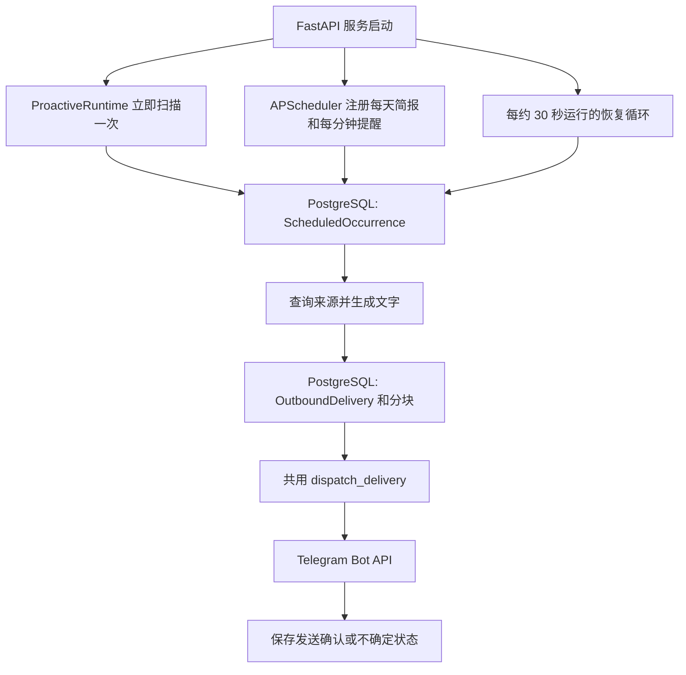
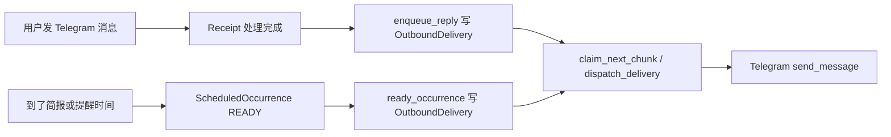

# 主动通知：每日简报与 Todo 提醒怎样按时发送

本文以**当前工作树**的生产路径为准，解释两项功能从时间触发到 Telegram 投递的全过程。它们不需要用户在发送时再发一条消息，也不经过聊天 Agent 的 `create_agent` 工具循环。文中“已实现”指源码有完整路径；是否真的送达，还需要看运行配置、服务是否在线和 Telegram 返回的发送结果。

## 1. 先看整体：谁盯时间，谁负责发送

项目没有另起一个常驻的通知服务。FastAPI 应用启动时，[`app/main.py`](../../app/main.py) 在数据库、Store 和 Telegram 投递组件可用后创建 `ProactiveRuntime`，先做一次扫描，再在**当前 Python 进程**启动两个唤醒来源：

- **APScheduler**：每天到简报时间触发一次；另有每分钟一次的提醒检查。它相当于进程内的闹钟。[`register_daily_brief`](../../app/scheduler/daily_brief.py)、[`start_scheduler`](../../app/scheduler/reminders.py)
- **`ProactiveRuntime` 恢复循环**：约每 30 秒扫描 PostgreSQL 中已到时间、失败待重试或租约过期的发送任务。它负责进程重启后的继续处理，不依赖前一次闹钟仍在内存中。[`ProactiveRuntime.start/tick/_loop`](../../app/scheduler/proactive.py)

两者可能在相近时间唤醒同一件事。数据库中的稳定任务标识、唯一约束和领取锁负责避免因此创建两份发送意图；**闹钟不是“已经发给用户”的证据**。

**服务关闭时没有进程继续计时或发送。** 重新开启时，启动扫描会检查数据库中的未完成任务；因此数据库保存“该处理什么”，进程负责“现在去处理”。按需前台运行不等于电脑关闭后仍能准点通知。

## 2. 三种时间先分清

[`Todo` 表](../../app/db/models.py)里以下字段不是同一个意思：

| 字段 | 例子 | 用在本功能的方式 |
| --- | --- | --- |
| `due_date` | 周五 18:00 截止 | 可进入每日简报的到期／逾期排序，也可显示在提醒文字中；它自身**不等于**要在此刻通知。 |
| `planned_start_at` / `planned_end_at` | 周四 15:00–16:00 计划处理 | 表示计划时间窗；当前主动提醒的到期发现**不靠**这两个字段。 |
| `reminder_at` | 周四 14:50 发提醒 | 这是 Todo 单条提醒实际检查的通知时刻；还需 `reminder_state=ACTIVE`、未发送且 Todo 未完成。 |

例如“复习算法，周五截止，周四 14:50 提醒”：简报可以按周五的 `due_date` 介绍这项任务；单条 Telegram 提醒则在周四的 `reminder_at` 附近触发。两种通知可能都提到它，但各有自己的触发条件。

## 3. 每日简报：北京时间 8 点发生什么

当前代码默认 `DEFAULT_TIMEZONE=Asia/Shanghai`、`DAILY_BRIEF_HOUR=8`，并默认开启 `SCHEDULER_ENABLED` 和 `DAILY_RUNDOWN_ENABLED`；实际部署仍可由环境变量覆盖。[`Settings`](../../app/config.py) 和前台[`on_demand_runner`](../../app/on_demand_runner.py)都已设置为开启。启动器仍需操作者输入 `START`，不是开机自动运行。

1. **到点唤醒。** [`register_daily_brief`](../../app/scheduler/daily_brief.py)用 APScheduler 的 `CronTrigger` 注册每日 8 点；触发后 `configured_daily_briefs()` 调用当前 `ProactiveRuntime.tick()`。启动时和约每 30 秒的恢复扫描也会调用 `tick()`，所以即使错过了单次 Cron 回调，仍可按数据库状态判断。
2. **逐用户建立计划任务。** [`upsert_daily`](../../app/scheduler/proactive.py)读取 `User` 表，为每个已有用户计算本地日期、8 点计划时刻、Bot 身份和 Telegram 聊天 ID，形成稳定的 `occurrence_key`。`scheduled_occurrences` 的唯一约束确保同一任务重复扫描不变成两条。此时只是 `PENDING`，还没有调用模型或 Telegram。
3. **只在到点后领取。** `tick()` 只挑 `planned_at <= now` 的任务；[`claim_occurrence`](../../app/scheduler/proactive.py)用行锁和租约领取，并把 `attempts` 增一。另一个扫描者不能同时把同一条正常租约内的任务再领走。
4. **查这位用户的事实。** [`render_daily_occurrence`](../../app/scheduler/daily_brief.py)按 `occurrence.user_id` 查询未完成 Todo、今天尚未发送的提醒，以及当天 Calendar 事件。Todo 只来自该用户。Calendar 目前是**单账号 OAuth**：只有配置的 `GOOGLE_CALENDAR_OWNER_TELEGRAM_ID` 对应用户能读该账号的日历；其他用户会收到自己的 Todo 简报，文中标明日历未连接。Calendar 读取失败也会标明来源失败，不把失败说成“今天没有日程”。
5. **排序和生成内容。** [`build_snapshot`、`prioritize`](../../app/scheduler/rundown.py)按到期、逾期、优先级和日程冲突组织已有事实。如果确有可排序事项，`synthesize_order()` **另调用一次 Qwen 模型**，要求只从已有来源 ID 中挑最多三个重点；模型没有权力增添 Todo 或 Calendar 事实。调用失败、返回未知 ID 或没有可选事项时，采用规则排序或空事项文案。这个调用不是聊天 Agent 的新一轮 Tool Calling。
6. **持久化并发送。** `format_rundown()`形成文字。[`ready_occurrence`](../../app/scheduler/proactive.py)在同一数据库事务中把该任务改成 `READY`，并写入不可随意重生成的 `OutboundDelivery` 和消息分块。随后才调用共用的 [`dispatch_delivery`](../../app/telegram/durable.py)向 Telegram 发送。

**例子：**8 点简报可能写出“今日重点：16:00 项目会议、周五到期的复习算法”，还可列出冲突和即将触发的提醒。它依据查询到的记录生成；不能因为模型把某件事列为重点，就认为模型创建或修改了该任务。

## 4. Todo 提醒：设了 14:50 后怎样到时发送

1. **先有提醒定义。** 创建或更新 Todo 时，业务层保存 `reminder_at`，将提醒状态置为 `ACTIVE`，调整提醒时会增加 `reminder_version`。[`Todo` 模型](../../app/db/models.py)、[`crud.update_todo`](../../app/db/crud.py)
2. **发现即将到期的任务。** APScheduler 每分钟唤醒一次 [`check_and_send_reminders`](../../app/scheduler/reminders.py)；恢复循环也周期扫描。[`upsert_due_reminders`](../../app/scheduler/proactive.py)调用 `crud.claim_due_reminders`，查找提醒有效、未发送、Todo 未完成且时间已到或即将在约一分钟内到达的行。查询使用行锁。**提前发现不等于提前发送**：后续领取还要求 `ScheduledOccurrence.planned_at <= now`。
3. **保存稳定的提醒身份。** 对每条 Todo，程序把 Todo ID、用户、Bot、聊天 ID、提醒时刻和 `reminder_version` 组成稳定键，插入 `ScheduledOccurrence`。重复扫描同一版本、同一时刻不会创建无限份提醒；改期则会形成新版本，旧版本发送前仍需重新核验。
4. **发送前复核。** [`reminder_relevant` 与 `ready_occurrence`](../../app/scheduler/proactive.py)检查 Todo 仍存在、未完成、`reminder_state=ACTIVE`、提醒时刻和版本都没有变化。取消、完成或改期后，旧提醒应被跳过。Outbox 真正领取待发送分块时还会再检查一次，避免刚准备完文字就被用户取消的待办继续发送。[`claim_next_chunk`](../../app/telegram/durable.py)
5. **按模板生成并投递。** [`render_reminder_occurrence`](../../app/scheduler/reminders.py)读取标题、截止时间、优先级、说明和语言偏好，生成“⏰ 待办提醒”消息。**这里不调用 Qwen。** 然后与每日简报一样，先保存 `OutboundDelivery` 和分块，再由 `dispatch_delivery()`发送。
6. **确认终态。** Telegram 返回消息 ID 且所有分块确认发送后，[`reconcile_occurrence`](../../app/scheduler/proactive.py)把任务记为 `DELIVERED`，并设置 Todo 的 `reminder_sent_at`。仅仅到了提醒时间、建了计划任务或尝试调用 Bot，都不等于已送达。

## 5. 和普通聊天回复是否共用发送逻辑

**共用实际发送底座，不共用入站触发。** 下面两条路最终调用的是同一个 `dispatch_delivery()` 和 `bot.send_message()`：

[`OutboundDelivery`](../../app/db/models.py)恰好关联一种来源：普通回复用 `receipt_id`，定时消息用 `occurrence_id`，数据库约束禁止两者同时存在或同时为空。发送前 [`claim_next_chunk`](../../app/telegram/durable.py)分别要求普通回复的 Receipt 为 `PROCESSED`、定时消息的 Occurrence 为 `READY`。这之后的分块领取、发送租约、Bot API 调用和发送结果记录是共用代码。普通回复的恢复扫描在 [`DurableTelegramRuntime`](../../app/telegram/durable_runtime.py)；定时任务的扫描在 `ProactiveRuntime`。所以它们**不是两套独立 Outbox**，也不是由 Telegram Webhook 来触发定时消息。

两张记录各回答一个不同问题：`ScheduledOccurrence` 的 `PENDING → CLAIMED → READY → DELIVERED` 表示“这次定时通知是否生成、是否完成”；`OutboundDelivery` 及其分块的 `PENDING → SENDING → SENT` 表示“这段文字的 Telegram 发送是否得到确认”。内容生成出错时前者可能转为 `FAILED`；发送超时时后者可能转为 `UNCERTAIN`。不能只看到前者为 `READY` 就告诉用户“已经收到提醒”。

## 6. 失败、重启和“准点”的实际边界

| 情况 | 当前代码怎样处理 | 不能因此声称什么 |
| --- | --- | --- |
| 服务在 8 点关闭 | 没有进程运行闹钟；重新启动时 `ProactiveRuntime.start()`立即扫描。简报只在计划时间后约 **3 小时**内补发，过时记为 `SKIPPED`。 | 不能说电脑关机也保证 8 点送达。 |
| 服务在 Todo 提醒时间关闭 | 重启后重新发现未发送的提醒；超过提醒时间约 **1 天**的旧提醒跳过。 | 不能说过期多久都补发。 |
| Calendar 查询失败 | 简报仍可使用该用户 Todo，并标明 Calendar 来源不可用。 | 不能说“没有日程”。 |
| 简报排序模型失败 | 回退到项目的确定性排序；提醒本身不依赖模型。 | 不能说简报必须依赖模型成功才会发。 |
| 内容生成失败 | Occurrence 记为 `FAILED`，约 30 秒后再尝试；领取最多 **5 次**，之后 `EXHAUSTED`。 | 不能说所有错误无限重试。 |
| Telegram 请求报错或超时 | 分块发送结果记为 `UNCERTAIN`；默认约 30 秒后可再次尝试，单个分块最多 **5 次**。已确认分块不重复发送，但远端可能其实已经收到过未确认的一次。 | 不能声称 Telegram 端端到端 Exactly-Once。 |
| 两次扫描同时发现同一任务 | 稳定唯一键避免重复 Occurrence，行锁和租约限制同一时刻的领取。 | 不能把这些机制说成经真实高并发流量证明。 |

上述期限和生成重试见 [`proactive.py`](../../app/scheduler/proactive.py)；发送结果状态见 [`durable.py`](../../app/telegram/durable.py)。APScheduler 是**唤醒器**，PostgreSQL 中的 `ScheduledOccurrence`、`OutboundDelivery` 与分块状态才是恢复时可查询的依据。

## 7. 当前验证到哪里

- 本轮在当前工作树运行了提醒、每日简报、主动投递、前台启动器和启动生命周期相关的合成环境测试：**63 passed**。其中 Fake Bot／SQLite 与模拟启动验证的是逻辑和状态转换，不是用户实际收到了 Telegram 消息。相关入口包括 [`test_r4_3_proactive.py`](../../tests/test_r4_3_proactive.py)、[`test_reminders.py`](../../tests/test_reminders.py)、[`test_daily_brief.py`](../../tests/test_daily_brief.py)、[`test_v2_rundown.py`](../../tests/test_v2_rundown.py)、[`test_durable_runtime.py`](../../tests/test_durable_runtime.py)。仓库另有隔离 PostgreSQL 集成测试，本轮没有重跑，不能把“文件存在”当作本轮通过。
- 2026-11-01 23:20（北京时间）短暂启动真实前台 Bot：`/health` 显示 `scheduler`、`proactive_delivery`、Webhook 均 ready；关闭后确认 8000 端口与 Funnel 已清理。库中当天两个用户的简报任务因已超过 8 点后的补发窗口而是 `SKIPPED`，主动 Outbox 新增发送为 **0**。因此这是**真实启动验收**，不是“8 点真实简报送达”或“真实 Todo 提醒已送达”的证据。
- 当前私有配置把时区设为 `Asia/Shanghai`、简报时间设为 8 点。默认开启只表示**启动前台服务时启动调度**；想准点收到早上简报，服务必须在该时刻运行。当前没有独立常驻后台服务。

一句话概括：**项目用进程内调度器唤醒扫描，用 PostgreSQL 保存每次主动通知的身份和状态，用共用 Outbox 向 Telegram 投递；每日简报可能额外用模型从已有事实中选重点，Todo 提醒不调用模型。**
